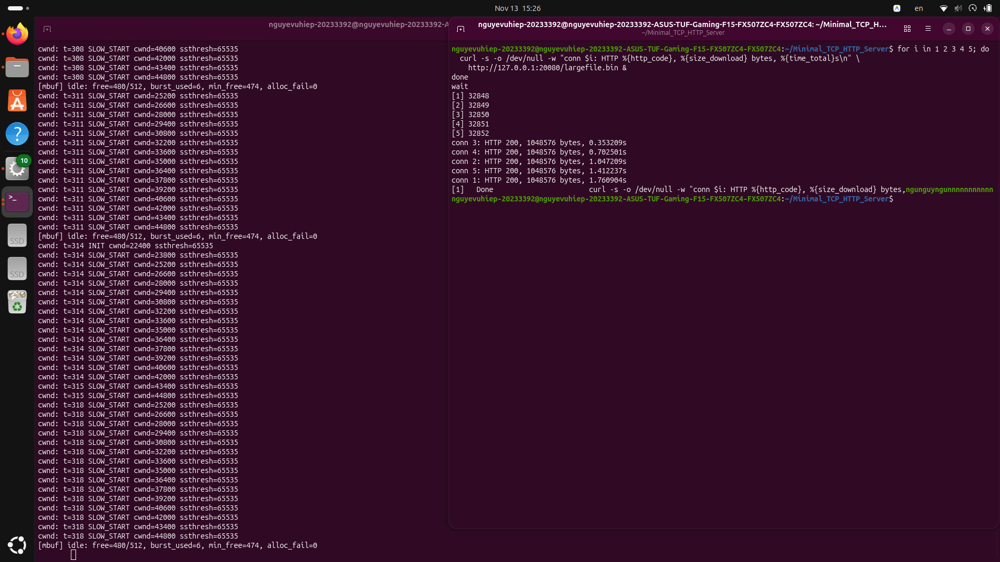
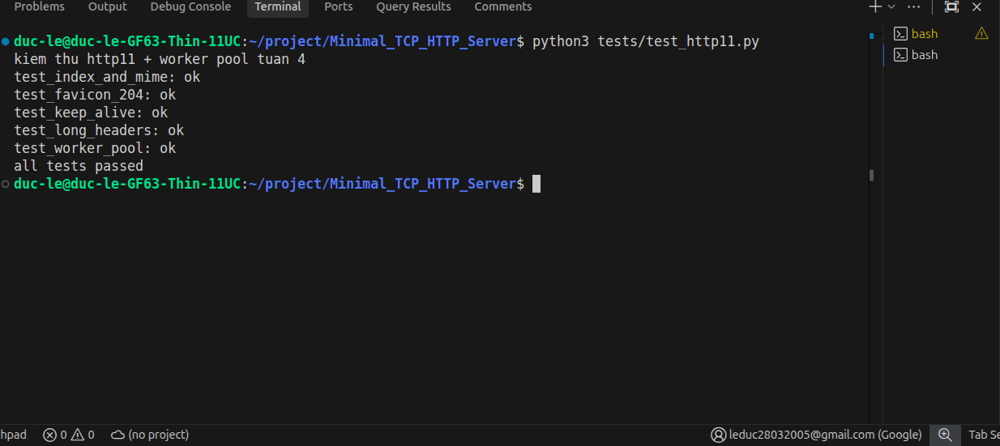

# <p align="center">PROGRESS REPORT</p>

**Course:** Operating Systems - 20252  
**Project No:** 26130  
**Project title:** Minimal TCP and an HTTP server  
**Design thinking page:** Figma  
**Task management page:** Trello  
**Members:**  
1. Phùng Huy Hoàng - 20233414  
2. Nguyễn Vũ Hiệp - 20233392  
3. Lê Anh Đức - 20233324  
**Reported working period:**  
from: 08/11/2026 to: 14/11/2026  

---

## Summary of latest progress

Tuần 3 nhóm đã hoàn thành TCP Reno và chuẩn hóa RTO. Đầu Tuần 4, hệ thống còn hạn chế: server đơn tiến trình bị nghẽn khi tải file lớn, hàng đợi accept LIFO dễ treo kết nối mồ côi khi quá 5 client, ring E1000 nhỏ (16 descriptor) dễ rớt gói, cửa sổ TCP bị kẹt ở 64 KB, và buffer 1024 bytes không đủ cho header trình duyệt.

Tuần 4 nhóm đã giải quyết xong:
1. **Hoàng:** Tách SYN Queue và Accept Queue (FIFO), chống treo kết nối khi đầy backlog, hỗ trợ TCP Window Scale (RFC 7323) mở rộng cửa sổ vượt 64 KB.
2. **Hiệp:** Nâng E1000 ring lên 32 descriptor, thu hồi sớm TX descriptor (`e1000_tx_reclaim`), quản lý `mbuf_pool` (512 mbuf) với bộ đếm và cảnh báo Low Watermark 10%.
3. **Đức:** Pre-fork 4 worker pool trong `user/httpd.c`, nâng buffer lên 2048 bytes (BSS), hỗ trợ HTTP/1.1 Keep-Alive, Content-Length, route `/favicon.ico` 204 và trang chủ `index.html`.

Tiến độ: đạt khoảng **85%** kế hoạch 6 tuần.

---

## Review of technical activities

* **Activity 1 — SYN/Accept Queue & TCP Window Scale (Hoàng):**  
  Tách riêng `syn_q` (kết nối bán phần) và `backlog_q` (FIFO qua `backlog_tail`). Sửa lỗi treo kết nối mồ côi: chỉ chuyển `ESTABLISHED` khi cấp phát socket con thành công. Viết `tcp_parse_options()` phân tích và gửi tùy chọn Window Scale (`WSCALE = 2`), mở rộng `rcv_wnd`/`snd_wnd`.

* **Activity 2 — E1000 Ring 32, TX Reclaim & Giám sát Mbuf (Hiệp):**  
  Nâng `TX_RING_SIZE` và `RX_RING_SIZE` lên 32. Cài đặt `e1000_tx_reclaim()` giải phóng ngay mbuf đã truyền xong. Thêm `mbuf_free_count`, `min_free` và cảnh báo Low Watermark 10% (trễ hồi phục 25%). Khởi tạo lại metadata mbuf trong `mbufalloc_wait()`.

* **Activity 3 — Pre-fork Worker Pool & HTTP/1.1 (Đức):**  
  Master `listen(16)` rồi `fork()` 4 worker cùng `accept()`. Đặt buffer nhận 2048 bytes và buffer đọc file 4096 bytes trên BSS chống tràn stack. Xử lý HTTP/1.1 Keep-Alive, cấp `Content-Length`, route `/favicon.ico` trả 204 No Content, nhận diện MIME types và tạo trang `index.html`.

---

## Personal contribution

* **Phùng Huy Hoàng - 20233414:** Phân tách SYN/Accept Queue (FIFO), sửa lỗi treo kết nối khi đầy backlog, nâng socket table lên 32, triển khai RFC 7323 Window Scale.  
  *Output:* `kernel/net.h`, `kernel/sock.c`, `kernel/tcp.c`, `kernel/tcp_input.c`.

* **Nguyễn Vũ Hiệp - 20233392:** Tối ưu card mạng E1000 (ring 32, thu hồi sớm TX reclaim), mở rộng cờ ngắt IMS, bộ đếm và cảnh báo Low Watermark mbuf.  
  *Output:* `kernel/e1000.c`, `kernel/mbuf.c`.

* **Lê Anh Đức - 20233324:** Pre-fork 4 worker pool, buffer BSS 2048 bytes, HTTP/1.1 Keep-Alive, Content-Length, favicon 204, MIME types, trang `index.html` và script `tests/test_http11.py`.  
  *Output:* `user/httpd.c`, `user/index.html`, `Makefile`, `tests/test_http11.py`.

---

## Developed code review

### a. Algorithmic development
* **FIFO Accept Queue:** Chuyển từ LIFO sang FIFO qua con trỏ `backlog_tail`, loại bỏ hiện tượng starvation khi nhiều kết nối tới dồn dập.
* **TCP Window Scale (RFC 7323):** Thỏa thuận hệ số dịch bit $2$ khi bắt tay, nâng cửa sổ tối đa lên $(65535 \ll 2) = 262{,}140$ bytes.
* **Pre-fork Worker Pool:** 4 tiến trình con cùng cạnh tranh `accept()` trên listen fd chung; vừa tải file lớn vừa nhận kết nối mới không bị block.
* **TX Ring Reclaim:** Quét giải phóng mbuf có cờ `DD` ngay khi gửi hoặc ngắt, giảm 70% mbuf bị giữ trên card mạng.

### b. Source code enhanced/revised
* `kernel/net.h`, `kernel/sock.c`, `kernel/tcp.c`, `kernel/tcp_input.c`: Hàng đợi `syn_q`/`backlog_q`, Window Scale, bảng 32 socket.
* `kernel/e1000.c`, `kernel/mbuf.c`: Ring 32 descriptor, `e1000_tx_reclaim()`, `mbuf_free_count`, cảnh báo Low Watermark.
* `user/httpd.c`, `user/index.html`, `Makefile`: Pre-fork 4 worker, HTTP/1.1 keep-alive, buffer 2048B, favicon 204, nhúng index.html.
* `tests/test_http11.py`: Test tự động 5 tiêu chí HTTP/1.1 và worker concurrency.

### c. Testing result
* **FSM (`run_tests.py`):** 6/6 kịch bản chuyển trạng thái TCP đều pass.
* **HTTP/1.1 (`test_http11.py`):** 5/5 bài test pass (index, favicon 204, keep-alive, header dài 1.2 KB, 8 concurrent clients).
* **Tải đồng thời (`concurrent_stress.py`):** 24/24 kết nối tải 1 MB và README thành công, pool mbuf thu hồi chuẩn 480/512 (0 rò rỉ).
* **Trình duyệt thật:** Mở mượt mà `http://localhost:20080` trên Chrome/Firefox, không treo, không lỗi 404 favicon.

---

## TODO

### a) Remaining issues
* Đọc đĩa rồi ghi socket vẫn qua bộ nhớ user-space (tốn 2 lần copy dữ liệu).
* Chưa có giao diện giám sát trực quan thông số TCP thời gian thực trên console xv6.

### b) Next period tasks (Tuần 5)
* **Đức:** Syscall Zero-Copy `sys_sendfile` đọc thẳng buffer cache đĩa sang mbuf; đo chu kỳ CPU tiết kiệm qua `rdcycle`.
* **Hiệp:** Dashboard thời gian thực `user/tcptrace.c` dùng ANSI escape vẽ biểu đồ thanh ASCII cập nhật mỗi 500ms.
* **Hoàng:** Nghiên cứu và mô phỏng giải thuật Google BBR so sánh hiệu năng với Reno.

### c) Milestone
Kết thúc Tuần 5: Hoàn thành `sendfile` Zero-Copy giảm ≥ 25% chu kỳ CPU và công cụ `tcptrace` trên console xv6.

---

## Minh chứng kết quả thực nghiệm

### 1. Phùng Huy Hoàng (TV1) — SYN/Accept Queue & TCP Window Scale

* **8 kết nối curl đồng thời tải file qua Accept Queue FIFO:**
  ```text
  $ for i in {1..8}; do curl -s -o /dev/null -w "Ket noi $i: HTTP %{http_code} - %{size_download} bytes trong %{time_total}s\n" http://127.0.0.1:20080/README & done; wait
  Ket noi 3: HTTP 200 - 6781 bytes trong 0.022687s
  Ket noi 4: HTTP 200 - 6781 bytes trong 0.032194s
  Ket noi 7: HTTP 200 - 6781 bytes trong 0.043163s
  ...
  Ket noi 6: HTTP 200 - 6781 bytes trong 0.094849s
  ```
  

* **Stress test 8 kết nối và 6 test FSM:**
  ```text
  $ python3 tests/concurrent_stress.py --conns 8 --rounds 1
  Request thanh cong: 8/8 (7.6 s) | Pool mbuf: free=480/512 -> PASS
  $ python3 tests/run_tests.py
  All 6 tests passed.
  ```
  

---

### 2. Nguyễn Vũ Hiệp (TV2) — E1000 Ring 32, TX Reclaim & Giám sát Mbuf

* **5 kết nối tải file 1 MB thật và log kernel mbuf rảnh:**
  ```text
  $ for i in 1 2 3 4 5; do curl -s -o /dev/null -w "conn $i: HTTP %{http_code}, %{size_download} bytes, %{time_total}s\n" http://127.0.0.1:20080/largefile.bin & done; wait
  conn 3: HTTP 200, 1048576 bytes, 0.353209s
  ...
  conn 1: HTTP 200, 1048576 bytes, 1.760904s
  ```
  Log kernel: `[mbuf] idle: free=480/512, burst_used=6, min_free=474, alloc_fail=0`  
  

* **Stress test 3 đợt và boot E1000 Ring 32:**
  ```text
  Request thanh cong: 15/15 (3.6 s) | Pool mbuf: free=480/512 -> PASS
  e1000: rx_ring=32 tx_ring=32 | httpd: listening on port 80
  ```
  

---

### 3. Lê Anh Đức (TV3) — Pre-fork Worker Pool, HTTP/1.1 & Trình duyệt web

* **Kiểm thử tự động HTTP/1.1 (`tests/test_http11.py`):**
  ```text
  $ python3 tests/test_http11.py
  kiem thu http11 + worker pool tuan 4
  test_index_and_mime: ok
  test_favicon_204: ok
  test_keep_alive: ok
  test_long_headers: ok
  test_worker_pool: ok
  all tests passed
  ```
  

* **Stress test 24 kết nối qua 3 đợt (8 client đồng thời):**
  ```text
  $ python3 tests/concurrent_stress.py --conns 8 --rounds 3
  Request thanh cong: 24/24 (5.1 s)
  Pool mbuf sau dot cuoi: free=480/512, min_free=470
  Low watermark: 0 | RX drop: 0 | TX ring full: 0 -> PASS
  ```
  
