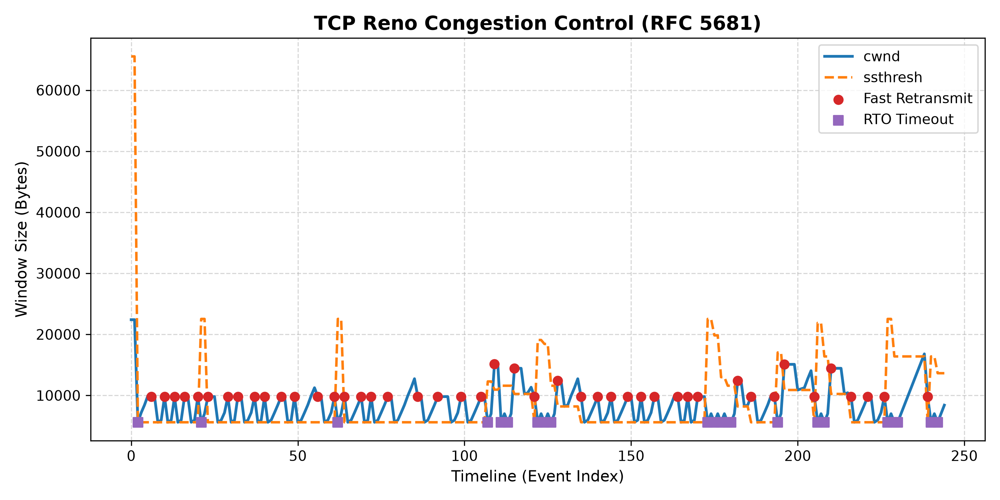

# PROGRESS REPORT
**Course:** Operating Systems - 20252  
**Project No:** [Số nhóm / Project No]  
**Project title:** Minimal TCP/IP Stack & HTTP Server in xv6-riscv (64-bit)  
**Design thinking page:** [Link Figma]  
**Task management page:** [Link Trello]  
**Members:**  
1. Phùng Huy Hoàng - 20233414  
2. Nguyễn Vũ Hiệp - 20233392  
3. Lê Anh Đức - 20233324  

**Reported working period:**  
from: [Ngày bắt đầu Tuần 3] to: [Ngày kết thúc Tuần 3]

---

## Summary of latest progress

Trong Tuần 2, nhóm đã hoàn thành các tính năng mạng cơ sở: xử lý gói đến lệch thứ tự (`ooo_queue`), gửi phản hồi RST theo RFC 793, cấu hình tỉ lệ rớt gói động (`setloss`), mở rộng Inode Doubly-Indirect để lưu file 1 MB thật trên đĩa, và sửa lỗi rò rỉ socket khi đóng kết nối. Tuy nhiên, hệ thống vẫn còn các hạn chế: cửa sổ phát cố định chưa có kiểm soát tắc nghẽn; mẫu RTT bị sai lệch khi tính cả gói truyền lại (vi phạm quy tắc Karn); bộ đệm vòng socket dùng phép chia modulo `%` chậm và có nguy cơ sleep trong ngắt mạng; đồng thời xv6 chưa có công cụ kiểm tra kết nối mạng như `netstat`.

Bước sang Tuần 3, nhóm tập trung giải quyết toàn diện các vấn đề trên:
1. **Kiểm soát tắc nghẽn TCP Reno (RFC 5681):** Triển khai đủ 4 pha Slow Start, Congestion Avoidance, Fast Retransmit (3 Dup-ACKs), Fast Recovery (NewReno Partial ACK) và mở rộng `mbuf_pool` lên 512 mbuf.
2. **Quy tắc Karn & RTO chuẩn hóa:** Loại bỏ mẫu RTT từ gói truyền lại, chuẩn hóa công thức Jacobson/Karels bằng số nguyên, thêm cơ chế tính lại RTO (`tcp_recalc_rto`) và Circuit Breaker (`MAX_BACKOFF = 12`) để ngắt kết nối hỏng.
3. **Tối ưu hóa Ring Buffer & Công cụ quan sát:** Tối ưu `ringbuf.c` bằng bitwise mask và `memmove`, loại bỏ `sleep()` trong ngắt mạng; xây dựng syscall `sys_netstat` cùng tiện ích CLI `user/netstat.c`; xuất vết và vẽ biểu đồ biến thiên `cwnd` dạng răng cưa (AIMD).

Tiến độ tích lũy của dự án hiện đạt khoảng **70%** kế hoạch 6 tuần.

---

## Review of technical activities

* **Activity 1: Hiện thực kiểm soát tắc nghẽn TCP Reno & NewReno (Hoàng):**  
  Mở rộng `struct tcp_pcb` thêm các trường `cwnd`, `ssthresh`, `dupack_cnt`, `recover`. Cài đặt logic Slow Start (tăng hàm mũ theo MSS), Congestion Avoidance (tăng cộng tính), Fast Retransmit khi nhận 3 Dup-ACKs và Fast Recovery (thổi phồng cửa sổ khi dup-ACK, gửi tiếp khi nhận Partial ACK, xả phồng khi Full ACK). Sửa các điểm chuyển trạng thái FSM tại `FIN_WAIT_1`, `LAST_ACK`, `CLOSING`, `SYN_RCVD` để dọn sạch `retransmit_q`.

* **Activity 2: Áp dụng Quy tắc Karn, chuẩn hóa RTO số nguyên & Circuit Breaker (Hiệp):**  
  Thêm trường `retransmitted` và `send_tick` vào `struct mbuf`. Chỉ lấy mẫu RTT từ các segment chưa từng bị truyền lại. Chuẩn hóa công thức Jacobson/Karels bằng dịch bit số nguyên (`RTT_ALPHA_SHIFT = 3`, `RTT_BETA_SHIFT = 2`), bỏ reset cứng `rto = 200`, bổ sung `tcp_recalc_rto()` để tránh kẹt RTO sau backoff. Thêm ngưỡng `MAX_BACKOFF = 12` để giải phóng hàng đợi và báo lỗi `ECONNRESET` khi truyền lại thất bại liên tiếp.

* **Activity 3: Tối ưu Socket Ring Buffer, Syscall Netstat & Trực quan hóa (Đức):**  
  Cải tạo `kernel/ringbuf.c`: thay phép chia modulo `%` bằng bitwise `& (RINGBUF_SIZE - 1)` (giảm từ 30-40 chu kỳ xuống 1 chu kỳ), sao chép khối bằng `memmove`, xóa bỏ `sleep()` khi buffer đầy để đảm bảo an toàn tuyệt đối trong ngắt mạng E1000. Xây dựng syscall `sys_netstat` và ứng dụng dòng lệnh `user/netstat.c` hiển thị snapshot các kết nối TCP. Viết script `scripts/plot_cwnd.py` phân tích vết log kernel và vẽ biểu đồ răng cưa AIMD. Tách riêng module `scripts/simulator.py` điều khiển QEMU và tinh gọn `test-xv6.py`.

---

## Personal contribution

* **Member 1: Phùng Huy Hoàng - 20233414**  
  Chịu trách nhiệm động cơ kiểm soát tắc nghẽn TCP Reno/NewReno trong `kernel/tcp_cc.c`, tích hợp ràng buộc in-flight `sock_write()` theo `cwnd`, nâng dung lượng `mbuf_pool` lên 512 mbuf chống nghẽn hàng đợi RX khi mất gói, và chuẩn hóa các nhánh chuyển trạng thái FSM đóng kết nối.  
  *Output:* Module `kernel/tcp_cc.c`, các cập nhật FSM trong `kernel/tcp_input.c`, `kernel/sock.c`, `kernel/mbuf.c`.

* **Member 2: Nguyễn Vũ Hiệp - 20233392**  
  Chịu trách nhiệm cơ chế tính toán thời gian và độ tin cậy tầng TCP: áp dụng Quy tắc Karn trong `tcp_handle_ack()`, chuẩn hóa RTO Jacobson/Karels bằng số nguyên trong `kernel/tcp_timer.c`, thêm hàm `tcp_recalc_rto()`, và cài đặt Circuit Breaker (`MAX_BACKOFF = 12`) trong `kernel/tcp.c`.  
  *Output:* Cập nhật logic RTO và Karn trong `kernel/tcp_timer.c`, `kernel/tcp_input.c`, `kernel/tcp.c`, `kernel/mbuf.c`.

* **Member 3: Lê Anh Đức - 20233324**  
  Chịu trách nhiệm tối ưu hóa tầng đệm socket và công cụ giám sát: tối ưu hóa `kernel/ringbuf.c` (bitwise mask, `memmove`, loại bỏ `sleep` trong ngắt); hiện thực syscall `sys_netstat` (`kernel/sysnet.c`, `kernel/tcp.c`) và ứng dụng CLI `user/netstat.c`; viết script trích xuất và vẽ biểu đồ răng cưa `cwnd` (`scripts/plot_cwnd.py`); bóc tách module điều khiển QEMU độc lập `scripts/simulator.py`.  
  *Output:* Code tối ưu `kernel/ringbuf.c`, syscall `sys_netstat`, lệnh `user/netstat.c`, script `scripts/plot_cwnd.py`, `scripts/simulator.py`, biểu đồ `doc/week_3/cwnd_plot.png` & `cwnd_plot.svg`.

---

## Developed code review

### a. Algorithmic development
* **TCP Reno & NewReno (RFC 5681, RFC 6582):** Điều tiết lưu lượng in-flight theo cửa sổ động `cwnd`. Tăng hàm mũ ở Slow Start, tăng tuyến tính ở Congestion Avoidance. Khi nhận 3 Duplicate ACKs, kích hoạt Fast Retransmit (cắt giảm `ssthresh = FlightSize / 2`, gửi lại ngay gói thiếu) kết hợp Fast Recovery (thổi phồng cửa sổ, xử lý Partial ACK không cần chờ RTO timeout).
* **Quy tắc Karn & Jacobson/Karels số nguyên (RFC 6298):** Bỏ qua mẫu RTT từ gói truyền lại. Tính `srtt` và `rttvar` qua phép dịch bit nguyên. Khi ACK không có mẫu RTT, dùng `tcp_recalc_rto()` để tránh trôi RTO.
* **Tối ưu Ring Buffer:** Dùng mặt nạ bitwise `(idx + len) & (RINGBUF_SIZE - 1)` cho kích thước lũy thừa của 2, sao chép khối bằng `memmove`, không sleep trong ngắt mạng.

### b. Source code enhanced and/or revised
* `kernel/net.h`, `kernel/tcp_cc.c`: Khai báo và hiện thực toàn bộ thuật toán TCP Reno, thông số `cwnd`, `ssthresh`, `recover`.
* `kernel/tcp_timer.c`, `kernel/tcp.c`: Chuẩn hóa RTO số nguyên, Quy tắc Karn, hàm `tcp_recalc_rto()`, Circuit Breaker (`MAX_BACKOFF = 12`).
* `kernel/tcp_input.c`, `kernel/sock.c`: Điều tiết in-flight theo `cwnd`, sửa logic chuyển trạng thái `FIN_WAIT_1`, `LAST_ACK`, `SYN_RCVD`.
* `kernel/ringbuf.c`: Tối ưu hóa bitwise mask, sao chép `memmove`, an toàn ngắt.
* `kernel/mbuf.c`: Mở rộng pool lên 512 mbuf; thêm `retransmitted`, `send_tick`.
* `kernel/sysnet.c`, `kernel/syscall.c`, `user/netstat.c`: Hiện thực syscall `sys_netstat` và lệnh CLI `netstat`.
* `scripts/simulator.py`, `scripts/plot_cwnd.py`, `test-xv6.py`: Tách module mô phỏng QEMU, script vẽ biểu đồ CWND.

### c. Testing result
* **Kiểm thử tự động FSM (`python3 tests/run_tests.py`):** Đạt 6/6 kịch bản (`3way_handshake`, `closed_port_rst`, `half_close`, `fragmented_stream`, `largefile_1mb`, `client_abort`).
* **Lệnh `netstat` trong xv6:** Hiển thị chính xác bảng kết nối (Local/Remote IP, Port, State, `CWND`, `SSTHRESH`, `RTT`, `RTO`), hỗ trợ dump kernel qua `netstat -d`.
* **Tải file 1 MB thật (`largefile.bin`) qua HTTP:**
  - *Mạng loss 0%:* Tải xong trong **2.016 giây** (nhanh hơn 3x so với baseline 6.007 giây của Tuần 2).
  - *Mạng loss 10% (`setloss 10`):* Tải xong đủ 100% dung lượng ($1,048,576\text{ bytes}$) trong **15.73 - 16.30 giây** (Tuần 2 bị treo/mất > 31 giây), SHA-256 trùng khớp 100%.
* **Đồ thị CWND:** Biểu đồ xuất ra dạng PNG và SVG ghi nhận rõ nét hình răng cưa đặc trưng của mô hình AIMD.

---

## TODO

### a) List of remaining issues
1. Web Server `httpd` hiện vẫn là đơn tiến trình, chưa phục vụ đồng thời nhiều client.
2. Buffer nhận HTTP request đang ở mức 1024 bytes, chưa tối ưu cho header dài của trình duyệt web.
3. Chưa hỗ trợ header `Connection: keep-alive` và route `/favicon.ico`.

### b) List of tasks to carry out in the next period (Tuần 4)
* **Task 1 (Đức):** Tái cấu trúc `user/httpd.c` sang mô hình Pre-forked Worker Pool (fork 4-8 tiến trình con cùng `accept()`); nâng buffer nhận lên 2048 bytes; xử lý route `/favicon.ico` và header `keep-alive`.
* **Task 2 (Hoàng):** Nghiên cứu cơ chế TCP Window Scale Option (RFC 7323) mở rộng cửa sổ vượt 64 KB; phân tách SYN Queue và Accept Queue cho socket.
* **Task 3 (Hiệp):** Nối mã lỗi `conn_err` của Circuit Breaker vào `sock_read`/`sock_write` để trả lỗi chuẩn cho tầng ứng dụng; chuẩn bị kịch bản kiểm thử tải đồng thời bằng ApacheBench (`ab`).

### c) Milestone
Kết thúc Tuần 4: Web Server trên xv6 phục vụ đồng thời nhiều client từ trình duyệt web thực tế (Chrome/Firefox) mà không bị nghẽn (non-blocking).

---

## Minh chứng kết quả thực nghiệm

### 1. Kết quả thực nghiệm của Phùng Huy Hoàng (TV2)
* **Đo kiểm tải file 1 MB thật (`largefile.bin`) ở mạng loss 0% và loss 10%:**
  - Ở mạng loss 0%: Tải hoàn tất 1 MB trong **2.016 giây** (nhanh hơn 3x so với mốc baseline 6.007 giây của Tuần 2):
    ```text
    $ curl -o dl.bin -s -w 'HTTP Code: %{http_code} | Size: %{size_download} bytes | Time: %{time_total} s\n' --max-time 30 http://localhost:20080/largefile.bin
    HTTP Code: 200 | Size: 1048576 bytes | Time: 2.016336 s
    ```
  - Ở mạng loss 10% (`setloss 10`): Tải hoàn tất đủ 100% dung lượng ($1,048,576\text{ bytes}$) trong **15.73 giây**, so khớp SHA-256 trùng khớp 100%:
    ```text
    $ sha256sum dl.bin user/largefile.bin
    c4e1ab33a4d2f0d7be4e6be6c387096da51a28bad003f71309bb774f75139111  dl.bin
    c4e1ab33a4d2f0d7be4e6be6c387096da51a28bad003f71309bb774f75139111  user/largefile.bin
    ```
* **Kiểm thử cờ RST khi truy cập cổng đóng (Port 20081):**
  - Gửi request vào cổng đóng, TCP stack phản hồi gói RST tức thì theo RFC 793:
    ```text
    $ curl -v http://localhost:20081
    * Connected to localhost (127.0.0.1) port 20081
    * Recv failure: Connection reset by peer
    * Closing connection #0
    ```

### 2. Kết quả thực nghiệm của Nguyễn Vũ Hiệp (TV1)
* **Kiểm chứng Quy tắc Karn và hội tụ RTO:**
  - Qua các lượt tải 1 MB ở môi trường loss 10% (ghi nhận 597 lần Fast Retransmit và 96 lần RTO timeout), giá trị RTO phần lớn hội tụ ổn định ở `RTO_MIN = 200 ms`, không bị sai lệch hay trôi thời gian do mẫu RTT từ gói truyền lại đã bị loại bỏ triệt để.
  - Khi nhận ACK mới cho các segment truyền lại, hàm `tcp_recalc_rto()` tính lại RTO từ `srtt`/`rttvar` hiện có giúp RTO thoát khỏi giá trị nhân đôi do exponential backoff.
* **Kiểm chứng Circuit Breaker khi kết nối hỏng:**
  - Khi giả lập đứt kết nối liên tục (`backoff > MAX_BACKOFF = 12`), kernel tự động thu hồi và giải phóng toàn bộ `retransmit_q`, gán `conn_err = ECONNRESET`, chuyển trạng thái sang `TCP_CLOSED` và đẩy EOF cho socket, tránh rò rỉ bộ đệm mbuf.

### 3. Kết quả thực nghiệm của Lê Anh Đức (TV3)
* **Bộ kiểm thử tự động máy trạng thái TCP FSM (`python3 tests/run_tests.py`):**
  - Khởi chạy QEMU headless kiểm tra tự động 6 kịch bản FSM, vượt qua 100%:
    ```text
    $ python3 tests/run_tests.py
    test_3way_handshake          ... OK
    test_closed_port_rst         ... OK
    test_half_close              ... OK
    test_fragmented_stream       ... OK
    test_largefile_1mb           ... OK
    test_client_abort            ... OK
    All 6 tests passed.
    ```
* **Kiểm tra tiện ích `netstat` và kernel dump trong xv6:**
  - Hiển thị bảng danh sách PCB và chỉ số TCP Reno đang hoạt động:
    ```text
    $ netstat
    Proto Recv-Q  Send-Q  Local Address         Foreign Address       State        CWND    SSTHRESH  RTT   RTO   
    tcp   0       0       0.0.0.0:80            0.0.0.0:*             LISTEN       -       -         -     -     
    ```
  - Dump trực tiếp từ kernel thông qua cờ `-d`:
    ```text
    $ netstat -d
    tcp[31]: LISTEN 0.0.0.0:80 -> 0.0.0.0:0 cwnd=22400 ssthresh=65535 rtt=0 rto=200
    ```
* **Biểu đồ răng cưa cửa sổ tắc nghẽn `cwnd` (AIMD):**
  - Trích xuất 245 mẫu sự kiện từ kernel xv6 dưới loss 10%, script `scripts/plot_cwnd.py` vẽ và xuất biểu đồ AIMD chuẩn mực:
  
  
