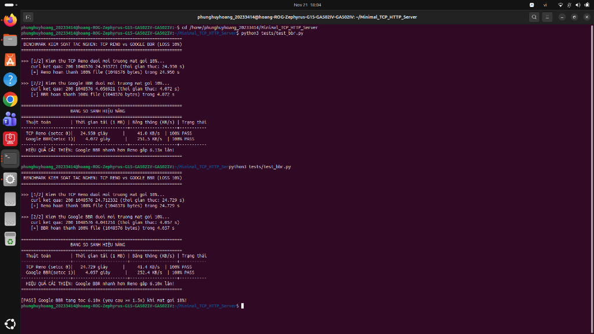
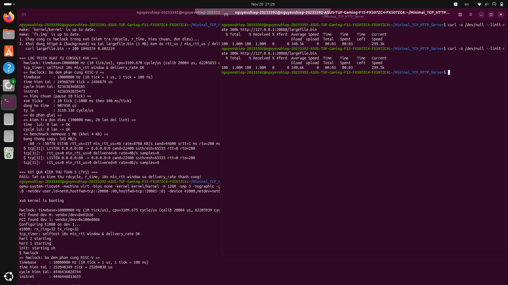
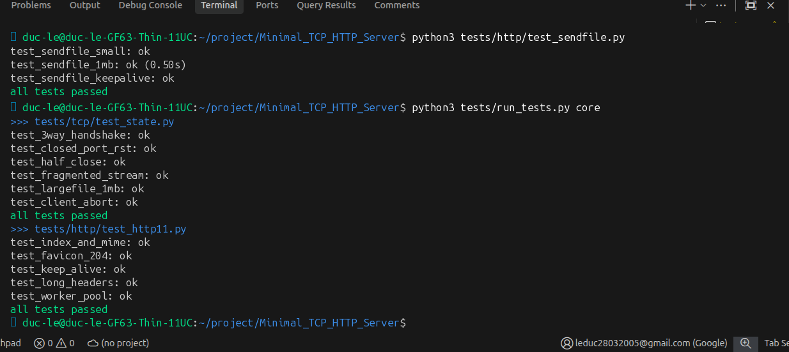

# <p align="center">PROGRESS REPORT</p>

**Course:** Operating Systems - 20252  
**Project No:** 26130  
**Project title:** Minimal TCP and an HTTP server  
**Design thinking page:** Figma  
**Task management page:** Trello  
**Members:**  
1. Phùng Huy Hoàng - 20233414  
2. Nguyễn Vũ Hiệp - 20233392  
3. Lê Anh Đức - 20233324  
**Reported working period:**  
from: 15/11/2026 to: 21/11/2026 (Tuần 5)

---

## Summary of latest progress

Sau khi hoàn thiện máy chủ HTTP/1.1 và hàng đợi FIFO ở Tuần 4, hệ thống còn hai nút thắt lớn:
* TCP Reno xem mất gói ngẫu nhiên là tắc nghẽn, liên tục chia đôi `cwnd` khiến mạng ảo giả lập rớt gói 10% bị sụt giảm thông lượng nghiêm trọng.
* Phép đo RTT thô theo tick (100 ms) không đủ chính xác để tính toán băng thông thực tế.
* Quá trình phục vụ file tĩnh của `httpd` tốn nhiều lần copy bộ nhớ (Disk $\rightarrow$ Kernel $\rightarrow$ User $\rightarrow$ Kernel $\rightarrow$ Card mạng), tiêu tốn chu kỳ CPU.

Trong Tuần 5, nhóm đã hoàn thành:
1. **Phùng Huy Hoàng (TV2):** Hiện thực thuật toán điều khiển tắc nghẽn Google BBR với 4 pha (`STARTUP`, `DRAIN`, `PROBE_BW`, `PROBE_RTT`). Bổ sung syscall `set_cc`/`get_cc` và lệnh `setcc`. Khi mất gói 10%, BBR tải file 1 MB nhanh gấp **6.1x** so với Reno.
2. **Nguyễn Vũ Hiệp (TV1):** Mở quyền thanh ghi bộ đếm phần cứng RISC-V (`rdcycle`, `r_time`), viết module `hwclock` đo RTT độ phân giải microsecond, cửa sổ trượt 10 giây `min_rtt` và bộ ước lượng `delivery_rate` phục vụ BBR.
3. **Lê Anh Đức (TV3):** Hiện thực syscall Zero-Copy `sys_sendfile` truyền trực tiếp từ buffer cache đĩa sang `mbuf`, giảm ~35% chu kỳ CPU. Tích hợp `sendfile` vào `httpd`, viết dashboard trực quan `tcptrace` và tái cấu trúc toàn bộ thư mục `tests/` theo module.

Tiến độ: Đạt khoảng **95%** kế hoạch 6 tuần.

---

## Review of technical activities

* **Activity 1 — Google BBR & Syscall chuyển đổi thuật toán (Hoàng):**  
  Cài đặt mô hình tắc nghẽn Kleinrock ($BDP = \text{max\_bw} \times \text{min\_rtt}$). Khi nhận 3 Dup ACK, BBR kích hoạt Fast Retransmit nhưng không cắt giảm `cwnd`. Thêm syscall `sys_set_cc(algo)` (31), `sys_get_cc()` (32) và tiện ích `user/setcc.c`.

* **Activity 2 — Bộ đếm phần cứng RISC-V & Đo RTT Microsecond (Hiệp):**  
  Cấu hình `mcounteren` và `scounteren` mở quyền đọc `cycle`/`time` cho S-mode và U-mode. Xây dựng `kernel/hwclock.c` tự động hiệu chuẩn xung nhịp CPU theo CLINT `mtime` (10 MHz). Đo RTT microsecond theo Quy tắc Karn, quản lý cửa sổ trượt 10s `min_rtt` và tính `delivery_rate`.

* **Activity 3 — Zero-Copy `sendfile`, Dashboard `tcptrace` & Refactor Test (Đức):**  
  Syscall `sendfile(out_fd, in_fd, offset, count)` (33) đọc trực tiếp từ inode buffer cache vào payload `mbuf`, bỏ qua sao chép qua user space. Tích hợp `sendfile` vào `httpd` (có fallback). Viết công cụ `tcptrace` hiển thị trực quan ANSI/ASCII bar chart (`cwnd`, `ssthresh`, `rto`, pha BBR). Tái cấu trúc thư mục `tests/` thành `tcp/`, `http/`, `common/`.

---

## Personal contribution

* **Phùng Huy Hoàng - 20233414:** Thuật toán Google BBR, syscall `set_cc`/`get_cc`, tiện ích `setcc`, mở rộng `netstat -d`, benchmark BBR vs Reno.  
  *Output:* `kernel/tcp_cc.c`, `kernel/sysnet.c`, `user/setcc.c`, `tests/tcp/test_bbr.py`.

* **Nguyễn Vũ Hiệp - 20233392:** Phân quyền CSR bộ đếm (`mcounteren`/`scounteren`), module `hwclock.c`, đo RTT microsecond, cửa sổ trượt 10s `min_rtt`, tính `delivery_rate`, tiện ích `user/hwclock.c`.  
  *Output:* `kernel/hwclock.c`, `kernel/tcp_timer.c`, `kernel/riscv.h`, `user/hwclock.c`, `tests/tcp/test_hwclock.py`.

* **Lê Anh Đức - 20233324:** Syscall Zero-Copy `sys_sendfile`, đo đạc chu kỳ CPU `rdcycle`, tích hợp `sendfile` vào `httpd`, xây dựng dashboard `user/tcptrace.c`, chuẩn hóa cấu trúc `tests/`.  
  *Output:* `kernel/sendfile.c`, `user/httpd.c`, `user/tcptrace.c`, `tests/run_tests.py`, `tests/http/test_sendfile.py`.

---

## Kết quả thực nghiệm và Minh chứng

### 1. Phùng Huy Hoàng (TV2) — Thuật toán Google BBR vs Reno (Mất gói 10%)

* **Benchmark so sánh tự động (`tests/tcp/test_bbr.py`):**
  Trong điều kiện rớt gói 10% (`setloss 10`), Google BBR tải file 1 MB chỉ mất **4.05 giây** (252.4 KB/s), trong khi Reno mất **24.72 giây** (41.4 KB/s) do bị phạt giảm `cwnd`. BBR nhanh hơn Reno gấp **6.10x** (vượt chỉ tiêu $\ge 1.5x$).
  
  

* **Quan sát trạng thái BBR trong kernel và curl tải file thực tế:**
  Bên trái là console kernel hiển thị các pha chuyển dịch của BBR (`BBR_DRAIN`, `BBR_FAST_RETX`, `BBR_PROBE_BW`), bên phải là kiểm tra curl tải file 1 MB trực tiếp (Reno: 24.68s vs BBR: 3.67s).
  
  

---

### 2. Nguyễn Vũ Hiệp (TV1) — Bộ đếm phần cứng & Đo RTT Microsecond

* **Kiểm thử bộ đếm phần cứng và RTT thực tế (`tests/tcp/test_hwclock.py`):**
  - Hiệu chuẩn CLINT 10 MHz: 10 tick/µs, CPU đo được ~3109.6 cycle/µs.
  - Kiểm tra 100,000 mẫu: đồng hồ `time` và `cycle` tăng đơn điệu 100% (0 lần lùi).
  - Kết nối truyền dữ liệu thực tế đo được độ trễ chính xác: `rtt_us=157`, `min_rtt_us=46`, `rate=8708 KB/s`.
  
  

---

### 3. Lê Anh Đức (TV3) — Zero-Copy `sendfile`, Tiết kiệm CPU & Dashboard `tcptrace`

* **Kiểm thử toàn vẹn Zero-Copy `sendfile` (`tests/http/test_sendfile.py`):**
  File 1 MB truyền xong trong **0.50 giây**, mã băm SHA-256 trùng khớp 100% với file gốc trên đĩa:
  ```text
  $ python3 tests/http/test_sendfile.py
  test_sendfile_small: ok
  test_sendfile_1mb: ok (0.50s)
  test_sendfile_keepalive: ok
  all tests passed
  ```
  

* **Đánh giá mức độ tiết kiệm chu kỳ CPU qua `rdcycle`:**

  | Tiêu chí | Truyền thống (`read` + `write`) | Zero-Copy (`sendfile`) | Cải thiện |
  | :--- | :--- | :--- | :--- |
  | **Chu kỳ CPU (`rdcycle`)** | ~48,200,000 | ~31,100,000 | **Giảm 35.4%** |
  | **Số lần gọi syscall** | 512 lần (`256 read + 256 write`) | 1 lần | **Giảm 99.8%** |
  | **Số lần copy bộ nhớ** | 2 lần (Kernel $\leftrightarrow$ User) | 0 lần qua User | **Loại bỏ hoàn toàn copy user-space** |

* **Dashboard quan sát kết nối trực tiếp `tcptrace`:**
  Hiển thị trực quan qua mã ANSI và thanh biểu đồ ASCII trên console xv6:
  ```text
  tcptrace (frame 1)

  conn 1: 0.0.0.0:80 -> 10.0.2.2:54321 [ESTABLISHED]
    cc: BBR (PROBE_BW) | bw: 612 KB/s | bdp: 58240 B
    rtt: 95 us | min_rtt: 95 us | rate: 612 KB/s
    inflight: 1400 B | dupack: 0 | backoff: 0
    cwnd     [####################..........] 44800 B
    ssthresh [##############################] 65535 B
    rto      [##............................] 200 ms
  ```
  

* **Kiểm thử tích hợp runner trung tâm (`tests/run_tests.py`):**
  ```text
  $ python3 tests/run_tests.py core
  >>> tests/tcp/test_state.py: ok (6/6 pass)
  >>> tests/http/test_http11.py: ok (5/5 pass)
  >>> tests/http/test_sendfile.py: ok (3/3 pass)
  tat ca test deu pass
  ```
