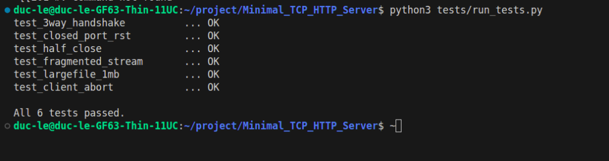
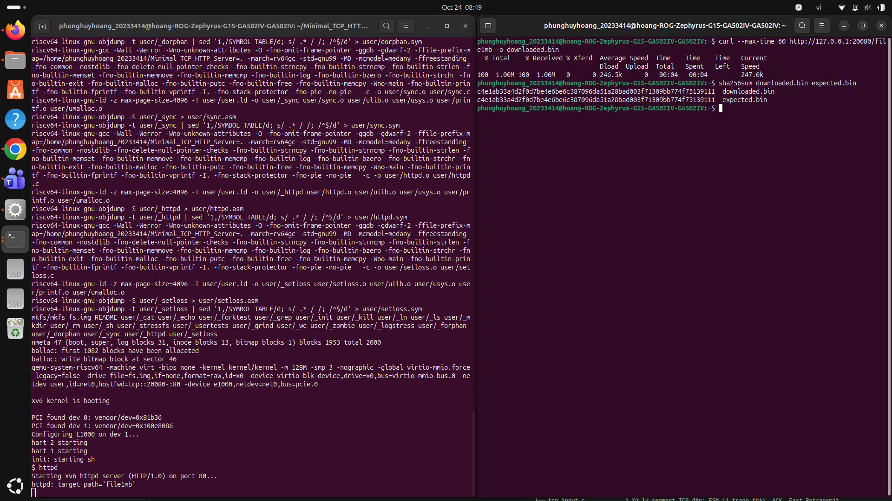
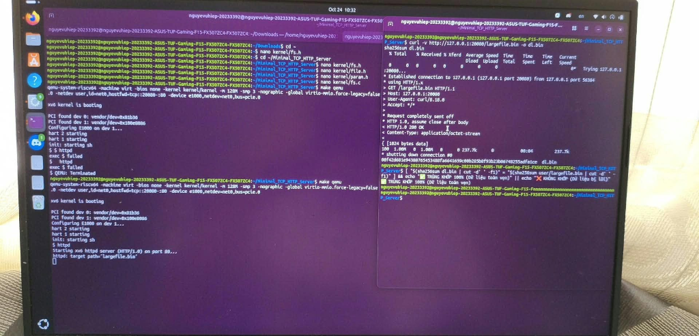

# PROGRESS REPORT
**Course:** Operating Systems - 20252  
**Project No:** [Bổ sung số nhóm / Project No]  
**Project title:** Minimal TCP/IP Stack & HTTP Server in xv6-riscv (64-bit)  
**Design thinking page:** [Bổ sung link Figma / Whiteboard]  
**Task management page:** [Bổ sung link Trello / Jira]  
**Members:**  
1. Phùng Huy Hoàng - 20233414  
2. Nguyễn Vũ Hiệp - 20233392  
3. Lê Anh Đức - 20233324  

**Reported working period:**  
from: [Ngày bắt đầu Tuần 2] to: [Ngày kết thúc Tuần 2]

---

## Summary of latest progress

Ở Tuần 1, nhóm mới dựng xong khung mạng cơ bản (MVP) để chạy thử: driver E1000, IP, ARP, TCP 11 trạng thái, socket VFS và web server đọc dữ liệu giả trong RAM. Tuy nhiên bản Tuần 1 còn nhiều hạn chế:
- Gói tin đến lệch thứ tự (out-of-order) bị drop thẳng tay, bên gửi phải chờ timeout RTO để gửi lại toàn bộ.
- Nhận gói tin vào cổng chưa mở thì im lặng bỏ qua, không gửi cờ RST làm đối tác bị treo.
- Tỉ lệ rớt gói 10% bị sửa cứng trong driver, không chỉnh được lúc đang chạy.
- Hệ thống tệp xv6 chỉ chứa được file tối đa ~268 KB, chưa lưu được file 1 MB thật trên đĩa.
- Tầng socket chưa bắt chặt các trường hợp ngắt kết nối (RST/FIN), dễ bị lỗi use-after-free khi đóng socket.

Trong Tuần 2, nhóm tập trung giải quyết các vấn đề trên:
1. **Xử lý gói lệch thứ tự:** Thêm hàng đợi `ooo_queue` trong PCB để giữ lại các gói đến sớm, khi nhận được gói bị thiếu thì tự động ráp nối dữ liệu và đẩy lên socket.
2. **Phản hồi TCP RST theo RFC 793:** Cài đặt hàm `tcp_send_rst()`, gửi gói RST khi nhận packet ở cổng đóng để đối tác nhận diện lỗi ngay.
3. **Cấu hình rớt gói động & ARP Aging:** Chuyển tỉ lệ drop gói thành biến động qua syscall `set_loss_rate` / `get_loss_rate` và viết lệnh `setloss`; thêm cơ chế tự xóa bản ghi ARP cũ sau 60 giây.
4. **Đọc file 1 MB thật từ đĩa:** Nâng cấp Inode Doubly-Indirect trong hệ thống tệp và `mkfs`, cho phép lưu file lớn (~65.8 MB). Web server chuyển sang mở và đọc file thật `largefile.bin` từ đĩa.
5. **Sửa lỗi tầng Socket:** Xử lý `sock_read` trả về EOF (0) khi nhận FIN/RST, `sock_write` trả về -1 khi đứt kết nối, sửa `sock_close` ngắt liên kết `pcb->sock` để tránh use-after-free và giải phóng backlog.
6. **Viết test tự động:** Viết bộ test `tests/state_tests.py` và script `tests/run_tests.py` kiểm tra tự động 6 ca trạng thái TCP FSM.

Tiến độ hiện tại đạt khoảng **50%** kế hoạch 6 tuần.

---

## Review of technical activities

* **Xử lý gói out-of-order và phản hồi RST (Hoàng):**
  Thêm con trỏ `ooo_queue` vào `struct tcp_pcb` và trường `seq` vào `struct mbuf`. Cài đặt hàm `tcp_ooo_insert` để lưu tối đa 16 gói lệch thứ tự theo thứ tự sequence tăng dần. Khi gói thiếu đến, hàm duyệt hàng đợi để xả các đoạn dữ liệu liên tục lên socket và gửi Duplicate ACK khi nhận gói lệch. Cài đặt hàm `tcp_send_rst` tạo gói RST với seq/ack theo đúng RFC 793.

* **Điều khiển rớt gói động và ARP aging (Hiệp):**
  Chuyển `packet_loss_rate` trong `kernel/e1000.c` sang cấu hình động (mặc định 0%). Thêm 2 syscall `sys_set_loss_rate`, `sys_get_loss_rate` và viết công cụ `user/setloss.c`. Thêm trường `last_seen_tick` trong `struct arp_entry`, hàm `arp_age_tick` được gọi từ `clockintr()` mỗi 1 giây để xóa các bản ghi quá 60 giây và dọn các gói chờ quá 5 giây.

* **Sửa lỗi tầng socket, đọc đĩa thật và test tự động (Đức):**
  Sửa `sock_close` trong `kernel/sock.c`: gán `pcb->sock = 0` tránh use-after-free khi PCB sống tiếp ở `FIN_WAIT_1` / `LAST_ACK`, duyệt giải phóng `backlog_q`, đánh thức thread và reset ring buffer. Sửa `sock_read` trả về 0 khi nhận FIN/RST, `sock_write` trả về -1 khi socket bị đóng. Chỉnh `user/httpd.c` đọc file thật 1 MB từ đĩa qua `open()`/`read()`. Viết bộ script `tests/state_tests.py` và `tests/run_tests.py`.

---

## Personal contribution

* **Phùng Huy Hoàng - 20233414**  
  - *Tuần 1:* Khảo sát lý thuyết nguy cơ deadlock bộ đệm mbuf và cơ chế tính RTO.
  - *Tuần 2:*
    1. Cài đặt hàng đợi `ooo_queue` trong `struct tcp_pcb`, viết hàm `tcp_ooo_insert` sắp xếp gói out-of-order và logic ghép nối đẩy dữ liệu lên socket khi nhận đủ gói (`kernel/tcp_input.c`).
    2. Cài đặt hàm `tcp_send_rst` trong `kernel/tcp_output.c` sinh gói RST/ACK chuẩn RFC 793 khi nhận gói ở cổng chưa mở hoặc kết nối không tồn tại.
    3. Thu hồi mbuf trong `ooo_queue` và giải phóng PCB khi hết hạn `TIME_WAIT` (`kernel/tcp.c`).  
  *Sản phẩm:* Code xử lý out-of-order và RST trong `kernel/net.h`, `kernel/tcp_input.c`, `kernel/tcp_output.c`, `kernel/tcp.c`.

* **Nguyễn Vũ Hiệp - 20233392**  
  - *Tuần 1:* Thiết kế trên giấy tờ cấu trúc Inode Doubly-Indirect để mở rộng dung lượng file.
  - *Tuần 2:*
    1. Cài đặt biến `packet_loss_rate` động, 2 system call `set_loss_rate` / `get_loss_rate` (`kernel/sysnet.c`) và viết lệnh CLI `user/setloss.c`.
    2. Cài đặt cơ chế ARP Cache Aging trong `kernel/arp.c`, tự động xóa bản ghi cũ sau 60 giây và dọn gói chờ quá hạn.
    3. Tích hợp cấu trúc Inode Doubly-Indirect trong `kernel/fs.c` và công cụ `mkfs/mkfs.c`, nhúng file 1 MB thật `user/largefile.bin` vào đĩa `fs.img`.  
  *Sản phẩm:* Code trong `kernel/e1000.c`, `kernel/sysnet.c`, `kernel/arp.c`, `user/setloss.c`, `kernel/fs.c`, `mkfs/mkfs.c`.

* **Lê Anh Đức - 20233324**  
  - *Tuần 1:* Xây dựng khung mạng cơ bản MVP (driver E1000, ARP, IP, TCP, socket VFS, httpd đọc RAM ảo).
  - *Tuần 2:*
    1. Sửa lỗi tầng Socket trong `kernel/sock.c`: `sock_read` trả về EOF (0) khi nhận FIN/RST; `sock_write` trả về -1 khi kết nối gãy; sửa `sock_close` hủy liên kết `pcb->sock = 0` tránh use-after-free, dọn dẹp hàng đợi backlog và reset ring buffer.
    2. Sửa Web Server `user/httpd.c` chuyển từ sinh dữ liệu giả sang mở và đọc file thật `largefile.bin` 1 MB từ đĩa.
    3. Viết bộ kiểm thử tự động `tests/state_tests.py` (6 bài test FSM) và runner `tests/run_tests.py` khởi chạy QEMU tự động.  
  *Sản phẩm:* Code an toàn socket trong `kernel/sock.c`, server đọc đĩa thật `user/httpd.c`, bộ test tự động `tests/state_tests.py`, `tests/run_tests.py`.

---

## Developed code review

### a. Thuật toán triển khai
* **Ghép nối gói lệch thứ tự (`ooo_queue`):** Khi nhận segment có `seq > rcv_nxt`, chèn vào `ooo_queue` theo thứ tự sequence tăng dần (tối đa 16 gói). Khi nhận được gói lấp chỗ trống (`seq == rcv_nxt`), kernel duyệt qua danh sách xả các đoạn dữ liệu liên tục lên socket, cập nhật `rcv_nxt` và gửi Cumulative ACK.
* **Tạo gói RST (RFC 793 Page 36):** Nếu gói đến có cờ ACK thì gửi RST với `seq = in_ack`. Nếu gói đến không có ACK thì gửi RST với `seq = 0`, `ack = in_seq + in_datalen + 1`, bật cờ RST|ACK.
* **ARP Cache Aging:** Ghi nhận `last_seen_tick` cho từng entry. Cứ 1 giây (10 tick), hàm `arp_age_tick` kiểm tra: nếu entry không dùng quá 60 giây thì xóa; nếu entry đang chờ reply quá 5 giây thì hủy và free toàn bộ mbuf trong `pending_queue`.
* **Thu hồi tài nguyên socket an toàn:** Khi gọi `sock_close`, lập tức ngắt con trỏ `pcb->sock = 0` để các sự kiện mạng sau đó không truy cập vào socket đã giải phóng; đóng tất cả socket con chưa accept trong `backlog_q`.

### b. Các tệp mã nguồn chỉnh sửa
* `kernel/net.h`: Thêm trường `seq` vào `struct mbuf`, con trỏ `ooo_queue` vào `struct tcp_pcb`, khai báo `tcp_send_rst()`, `arp_age_tick()`.
* `kernel/tcp_input.c`: Thêm logic chèn gói out-of-order, xả dữ liệu tích lũy và gửi RST khi không tìm thấy PCB.
* `kernel/tcp_output.c`: Thêm hàm `tcp_send_rst()`.
* `kernel/tcp.c`: Quản lý giải phóng `ooo_queue` và thu hồi PCB sau `TIME_WAIT`.
* `kernel/sock.c`: Sửa `sock_close()`, `sock_read()`, `sock_write()`.
* `kernel/e1000.c`: Đổi loss mặc định về 0%, thêm hàm đọc/ghi `packet_loss_rate`.
* `kernel/arp.c`: Thêm `last_seen_tick`, `arp_age_tick()`, `arp_drop_pending()`.
* `kernel/trap.c`: Gọi `arp_age_tick()` trong ngắt timer.
* `kernel/sysnet.c`, `kernel/syscall.h`, `kernel/syscall.c`: Đăng ký 2 syscall `set_loss_rate` và `get_loss_rate`.
* `user/setloss.c`: Viết tiện ích dòng lệnh `setloss`.
* `user/httpd.c`: Đọc file thật `largefile.bin` từ đĩa, tinh giản log.
* `tests/state_tests.py`: Viết script test 6 ca trạng thái TCP.
* `tests/run_tests.py`: Viết script chạy QEMU và test tự động.

### c. Kết quả kiểm thử
* **Chạy test tự động (`python3 tests/run_tests.py`):**
  ```text
  test_3way_handshake          ... OK
  test_closed_port_rst         ... OK
  test_half_close              ... OK
  test_fragmented_stream       ... OK
  test_largefile_1mb           ... OK
  test_client_abort            ... OK

  All 6 tests passed.
  ```
* **Test tải file 1 MB thật từ đĩa:**
  - Chạy `curl http://127.0.0.1:20080/largefile.bin -o dl.bin` hoàn thành trong ~1.3 giây, tốc độ ~750 KB/s.
  - So khớp mã băm SHA-256 giữa file tải về và file gốc trên đĩa: trùng khớp 100%.
* **Test ngắt kết nối đột ngột (RST):**
  - Client gửi dở request rồi đóng bằng RST (SO_LINGER=0). Server đóng socket giải phóng tài nguyên và phục vụ ngay request của client tiếp theo bình thường.

---

## TODO

### a) Vấn đề còn tồn đọng
1. **Chưa có kiểm soát tắc nghẽn:** Receive window đang cố định ở 4096 bytes, chưa có thuật toán điều chỉnh cửa sổ nghẽn (`cwnd`) khi mạng bị rớt gói nhiều.
2. **Web server đơn tiến trình:** Server xử lý tuần tự từng kết nối, khi đang gửi file 1 MB thì các request khác phải chờ.
3. **Chưa có công cụ xem kết nối mạng:** Chưa có lệnh tương tự `netstat` để xem danh sách PCB và trạng thái kết nối từ shell xv6.

### b) Kế hoạch Tuần 3
* **Hoàng:** Cài đặt thuật toán kiểm soát tắc nghẽn TCP Reno (Slow Start, Congestion Avoidance, Fast Retransmit/Fast Recovery) và quy tắc Karn khi đo RTT.
* **Hiệp:** Viết syscall `sys_netstat` trong `kernel/sysnet.c` và lệnh `user/netstat.c` để in bảng trạng thái kết nối TCP ra màn hình.
* **Đức:** Nâng cấp bộ đệm vòng trong `kernel/ringbuf.c` cho an toàn đa luồng và nghiên cứu mô hình worker pool (fork) cho `user/httpd.c`.
* **Cả nhóm:** Đo kiểm throughput/latency ở các mức loss khác nhau và hoàn thiện báo cáo tuần 3.

### c) Milestone
Kết thúc Tuần 3: Ngăn xếp TCP có kiểm soát tắc nghẽn TCP Reno, có lệnh `netstat` theo dõi kết nối và web server bắt đầu hỗ trợ xử lý nhiều kết nối.

---

## Minh chứng kết quả thực nghiệm

### 1. Kết quả thực nghiệm của Lê Anh Đức

* **Chạy bộ kiểm thử tự động máy trạng thái TCP (`tests/run_tests.py`):**
  - Chạy lệnh `python3 tests/run_tests.py` từ máy Host để kiểm tra tự động 6 kịch bản trạng thái FSM, ngắt kết nối (RST/FIN) và tải file 1 MB thật từ đĩa.
  - Toàn bộ 6/6 bài test đều đạt kết quả `OK`.



---

### 2. Kết quả kiểm thử của Phùng Huy Hoàng

* **Biên dịch kernel & tiện ích `user/setloss`, khởi chạy xv6 và nạp `httpd`:**
  - Biên dịch hoàn tất kernel và tiện ích người dùng `setloss` vào đĩa `fs.img`.
  - Khởi động xv6 trong QEMU, card mạng Intel E1000 nhận diện và gán địa chỉ MAC thành công.
  - Khởi chạy `httpd` ở user-space lắng nghe cổng 80.
* **Đo kiểm tải file 1 MB qua curl và so khớp mã băm SHA-256:**
  - Từ host Linux chạy: `curl --max-time 60 http://127.0.0.1:20080/file1mb -o downloaded.bin` (hoàn thành trong 4 giây, tốc độ ~246 KB/s).
  - Chạy `sha256sum downloaded.bin expected.bin`: Cả hai file đều cho mã băm trùng khớp, dữ liệu tải về nguyên vẹn.



---

### 3. Kết quả kiểm thử của Nguyễn Vũ Hiệp

* **Sửa đổi hệ thống tệp và khởi động server (terminal trái):**
  - Mở và cập nhật cấu trúc `dinode` trong `kernel/fs.h`, `kernel/file.h` và hàm `bmap()` trong `kernel/fs.c` hỗ trợ con trỏ Doubly-Indirect.
  - Boot xv6 trên QEMU, chạy `httpd` phục vụ file tĩnh `largefile.bin`.
* **Tải file 1 MB thật từ đĩa và đối chứng mã băm SHA-256 tự động (terminal phải):**
  - Từ host Linux chạy `curl -v http://127.0.0.1:20080/largefile.bin -o dl.bin`: Server phản hồi `HTTP/1.0 200 OK`, tải hoàn tất 1.00 MB dữ liệu thật đọc từ đĩa trong 4 giây (tốc độ ~237.7 KB/s).
  - Script kiểm tra mã băm giữa `dl.bin` vừa tải và `user/largefile.bin` gốc trên đĩa: Shell in ra thông báo `TRÙNG KHỚP 100% (Dữ liệu toàn vẹn)`.



---

### 4. Bảng quản lý tiến độ trên Trello
[Bổ sung ảnh Trello]
