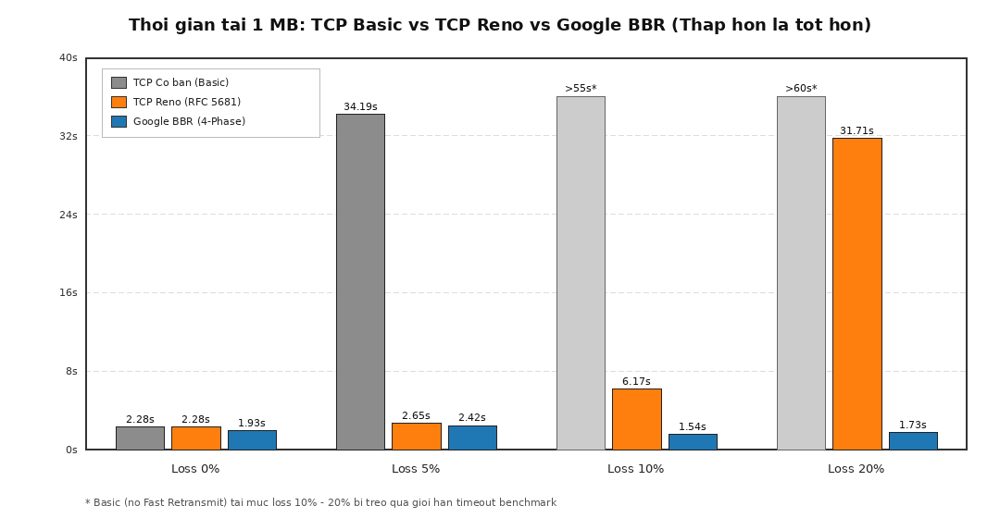
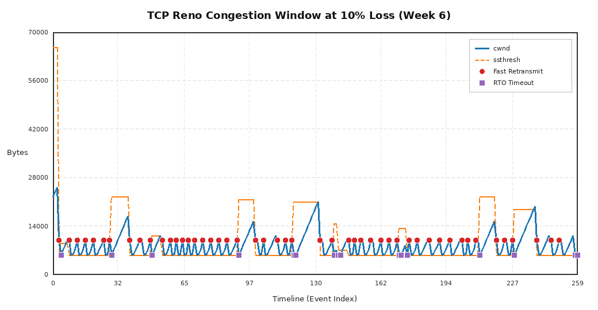
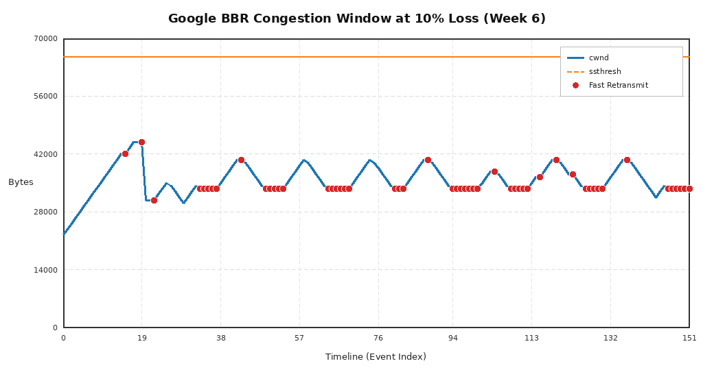

# TIẾN TRÌNH TUẦN 6 - PHÙNG HUY HOÀNG (MSSV: 20233414)
## Báo Cáo Triển Khai: Gia Cố Tình Huống Biên FSM (`TIME_WAIT` & Gói Rác), Tái Sử Dụng PCB Chống Bão Kết Nối, Benchmark Khoa Học Đa Mức Mất Gói & Đồ Thị `cwnd`

* **Người thực hiện:** Phùng Huy Hoàng - MSSV: 20233414
* **Tuần:** Tuần 6 (Week 6)
* **Repository:** Minimal_TCP_HTTP_Server (xv6-riscv 64-bit)

---

## 1. Mục Tiêu Kỹ Thuật Tuần 6

Theo lộ trình phối hợp Tuần 6 (`plans/weeks/week_6.md`, `plans/members/member_2_tv2.md`) và danh sách `TODO` từ `doc/baocao/baocao.md`:
1. **Gia cố tầng giao vận TCP trước các tình huống biên và gói tin dị dạng / gói rác:**
   - Kiểm tra chặt chẽ giới hạn trường `data offset` (`hlen <= m->len`) để ngăn đọc tràn vùng dữ liệu tùy chọn TCP.
   - Giới hạn miền chấp nhận ACK hợp lệ theo chuẩn RFC 793 / RFC 5681: $(\text{snd\_una}, \text{snd\_nxt}]$, loại bỏ hoàn toàn các ACK giả mạo vượt quá `snd_nxt` trong `ESTABLISHED`, `SYN_RCVD`, `FIN_WAIT_1`, `CLOSING`, `LAST_ACK`.
   - Kiểm tra đúng số thứ tự `seq == pcb->rcv_nxt` trước khi chuyển trạng thái khi nhận `FIN` (`ESTABLISHED` $\rightarrow$ `CLOSE_WAIT`, `FIN_WAIT_1` $\rightarrow$ `CLOSING`/`TIME_WAIT`, `FIN_WAIT_2` $\rightarrow$ `TIME_WAIT`), hỗ trợ đầy đủ **Simultaneous Close** (`FIN_WAIT_1` $\rightarrow$ `CLOSING` $\rightarrow$ `TIME_WAIT`).
   - Hỗ trợ trạng thái `TCP_TIME_WAIT` chuẩn RFC 793: trả `ACK` và tái lập bộ đếm `2 MSL` (`200` ticks $\approx 20\text{ giây}$) khi nhận lại `FIN` từ đối tác do `ACK` cuối bị thất lạc.
2. **An toàn khóa & Tái sử dụng `TIME_WAIT` PCB chống cạn kiệt pool khi tải dồn dập:**
   - Chuẩn hóa thứ tự khóa `tcp_mgr.lock` $\rightarrow$ `pcb->lock` trên toàn bộ đường xử lý `TCP_LISTEN` và thu hồi `TCP_TIME_WAIT`, loại bỏ nguy cơ `panic: acquire` hoặc tranh chấp giải phóng kép (double-free).
   - Bổ sung cơ chế tái sử dụng PCB `TCP_TIME_WAIT` cũ nhất (`tcp_pcb_recycle_timewait_locked`) khi bảng `32` PCB bị bão hòa bởi các kết nối `Connection: close` liên tiếp, đồng thời vẫn bảo toàn chu kỳ `2 MSL` trong điều kiện bình thường.
3. **Bổ sung chế độ Baseline (`CC_BASIC`) và Benchmark đa mức mất gói (0%, 5%, 10%, 20%):**
   - Triển khai chế độ `CC_BASIC` (`setcc 2`) mô phỏng TCP cơ bản (cửa sổ cố định 16 MSS, không Fast Retransmit / AIMD) để đối chiếu khoa học 3 thế hệ: **TCP Cơ bản $\rightarrow$ TCP Reno $\rightarrow$ Google BBR**.
   - Tự động thu thập trace `cwnd`, mở rộng `scripts/plot_cwnd.py` (hỗ trợ cả Reno, BBR và Pillow PNG/SVG) để vẽ biểu đồ biến thiên `cwnd` tại loss 10% cùng biểu đồ cột so sánh đa mức mất gói.
4. **Kiểm thử toàn diện tình huống biên & hồi quy hệ thống:**
   - Xây dựng `tests/tcp/test_edge_cases.py` và selftest kernel `netstat -t` (`tcp_edge_selftest`) kiểm tra cả gói rác, half-close, client abort (`SO_LINGER`), bão 40 kết nối `Connection: close` (> `32` PCB) và xác minh thu hồi sạch `TIME_WAIT` sau `2 MSL`.

---

## 2. Hiện Trạng Đầu Tuần & Các Lỗ Hổng Biên Đã Phát Hiện

Qua rà soát toàn bộ máy trạng thái trong `kernel/tcp_input.c` và `kernel/tcp.c` trên nền code đầu Tuần 6 (sau commit `d22f84e` của TV1):

| Hạng mục | Hiện trạng trước chỉnh sửa | Rủi ro / Lỗ hổng biên | Hướng xử lý |
| :--- | :--- | :--- | :--- |
| **Kiểm tra độ dài TCP Header (`hlen`)** | Chỉ kiểm tra `hlen < sizeof(tcphdr)`, thiếu `hlen > m->len` | Gói rác có `th->off = 0xf0` (`hlen = 60`) trên segment dài 24 byte gây đọc ngoài giới hạn `m->len` trong `tcp_parse_options()` | Chặn `hlen < 20 \|\| hlen > (int)m->len` ngay đầu `tcp_input()` |
| **Xác thực miền ACK trong `tcp_handle_ack()`** | Chỉ kiểm tra `(int32)(ack - snd_una) > 0` | Gói giả mạo/rác mang `ack > snd_nxt` có thể xóa sạch `retransmit_q` và đóng sớm `LAST_ACK` / `SYN_RCVD` | Bắt buộc `(int32)(ack - snd_una) > 0 && (int32)(ack - snd_nxt) <= 0`; kiểm tra `ack == snd_nxt` ở `SYN_RCVD` |
| **Xử lý `TCP_TIME_WAIT` khi nhận lại `FIN`** | Rơi vào nhánh `default: break;` và im lặng hủy gói | Nếu `ACK` cuối tới peer bị rớt, peer kẹt ở `LAST_ACK` truyền lại `FIN` liên tục | Bổ sung `case TCP_TIME_WAIT:` trả `ACK` và gia hạn `rto_deadline = ticks + 200` |
| **Đóng đồng thời & `FIN` lệch thứ tự** | `FIN_WAIT_1` chỉ xử lý `FIN` nằm bên trong `if (flags & TCP_FLAG_ACK)`; `ESTABLISHED`/`FIN_WAIT_2` chưa kiểm `seq == rcv_nxt` | Không đi qua được nhánh `TCP_CLOSING` khi đóng đồng thời; `FIN` rác sai `seq` làm hỏng trạng thái | Tách `FIN` khỏi `ACK` để vào `TCP_CLOSING` chuẩn RFC 793 và kiểm tra `seq == rcv_nxt` |
| **Cạn pool 32 PCB khi burst `TIME_WAIT` & Lock Order** | `TCP_LISTEN` giữ `pcb->lock` khi gọi `tcp_pcb_alloc()` / `tcp_pcb_insert()`; hết 32 PCB là từ chối kết nối | Hơn 31 kết nối `Connection: close` liên tiếp trong < 20 giây làm kẹt pool `TIME_WAIT`; giữ `pcb->lock` khi khóa `tcp_mgr.lock` có thể gây `panic: acquire` | Nhả `listen pcb->lock` trước `tcp_pcb_alloc()`, thu hồi `TIME_WAIT` chuẩn thứ tự `tcp_mgr.lock -> pcb->lock`, tái sử dụng `TIME_WAIT` cũ nhất khi hết pool |

---

## 3. Chi Tiết Triển Khai Kỹ Thuật

### 3.1. Gia cố `kernel/tcp_input.c` & Kernel Edge Selftest (`netstat -t`)

1. **Chặn gói rác cấu trúc & giả mạo ACK:**
   ```c
   int hlen = (th->off >> 4) * 4;
   if (hlen < (int)sizeof(struct tcphdr) || hlen > (int)m->len) {
     mbuffree(m);
     return;
   }
   ```
   Trong `tcp_handle_ack()`, mọi số ACK vượt quá biên đã gửi `snd_nxt` đều bị loại bỏ:
   ```c
   if ((int32)(ack - pcb->snd_una) > 0 && (int32)(ack - pcb->snd_nxt) <= 0)
   ```
   Trong `TCP_SYN_RCVD`, kiểm tra `ack == pcb->snd_nxt` trước khi rút PCB khỏi `syn_q` đẩy sang `backlog_q`, nếu sai thì phản hồi `RST` theo RFC 793.

2. **Hoàn thiện nhánh đóng kết nối & `TCP_TIME_WAIT`:**
   - **Simultaneous Close (`TCP_FIN_WAIT_1`):** Nếu nhận được `FIN` đúng thứ tự (`seq == pcb->rcv_nxt`) trước khi `FIN` của xv6 được ACK (`(int32)(pcb->snd_una - pcb->snd_nxt) < 0`), chuyển sang `TCP_CLOSING` và gửi `ACK`; khi nhận tiếp `ACK == snd_nxt` tại `TCP_CLOSING` thì chuyển sang `TCP_TIME_WAIT` (`rto_deadline = ticks + 200`).
   - **Retransmitted `FIN` trong `TCP_TIME_WAIT`:**
     ```c
     case TCP_TIME_WAIT:
       if ((flags & TCP_FLAG_FIN) && (int32)(seq - pcb->rcv_nxt) <= 0) {
         pcb->rto_deadline = ticks + 200;
         tcp_discard_and_ack(pcb, m);
         return;
       }
       break;
     ```
   - **An toàn khóa tại `TCP_LISTEN`:** Giải phóng `listen pcb->lock` sau khi đọc kiểm tra ngưỡng `ls->syn_cnt` / `ls->backlog_cnt`, rồi mới gọi `tcp_pcb_alloc()` và `tcp_pcb_insert(newpcb)`. Nhờ đó toàn hệ thống tuân thủ duy nhất một chiều khóa `tcp_mgr.lock` $\rightarrow$ `pcb->lock`.

3. **Tích hợp hàm tự kiểm tra biên `tcp_edge_selftest()` (gọi qua `netstat -t`):**
   Tạo 9 kịch bản tiêm gói tin giả lập trực tiếp vào `tcp_input()` trên một PCB thử nghiệm (dùng IP ảo `10.0.2.99` để tránh SLIRP gateway gửi `RST` nhiễu) kiểm tra đầy đủ: segment cụt 8 byte, `data offset` 60 byte trên gói 24 byte, sai checksum TCP, ACK vượt `snd_nxt`, `FIN` lệch thứ tự, ACK rác ở `SYN_RCVD`, Simultaneous Close `FIN_WAIT_1 -> CLOSING -> TIME_WAIT`, `FIN` truyền lại ở `TIME_WAIT`, ACK rác ở `LAST_ACK`, và kết thúc bằng kiểm toán `net_audit_collect()` xác nhận `tcp_zombie == 0`, `leaked == 0`.

### 3.2. Tái sử dụng `TIME_WAIT` an toàn trong `kernel/tcp.c`

* Trích xuất hàm dùng chung `tcp_pcb_detach_locked()` để gỡ PCB khỏi `hash_table` và `listen_list` dưới `tcp_mgr.lock`.
* Trong `tcp_pcb_free(pcb)`, bổ sung kiểm tra chống double-free nếu `pcb` đã nằm trong `tcp_mgr.free_list`.
* Trong `tcp_timer_process()`, việc thu hồi PCB `TCP_TIME_WAIT` hết hạn `2 MSL` được thực hiện theo thứ tự khóa `tcp_mgr.lock` $\rightarrow$ `pcb->lock` và kiểm tra lại điều kiện `pcb->state == TCP_TIME_WAIT && pcb->sock == 0`.
* Trong `tcp_pcb_alloc()`, nếu `tcp_mgr.free_list == 0` do cơn bão kết nối `TIME_WAIT`, hàm `tcp_pcb_recycle_timewait_locked()` chọn PCB `TCP_TIME_WAIT` có `rto_deadline` nhỏ nhất (lâu nhất) để thu hồi và cấp phát lại ngay, giúp server không bị từ chối kết nối khi tải dồn dập.

### 3.3. Bổ sung chế độ `CC_BASIC` (`setcc 2`), Tinh chỉnh sàn BDP của Google BBR & Nâng cấp công cụ vẽ đồ thị

* Thêm hằng số `CC_BASIC = 2` (`kernel/net.h`, `user/user.h`), hỗ trợ trong `kernel/tcp_cc.c` (cửa sổ cố định 16 MSS, bỏ qua Duplicate ACK, chỉ phục hồi qua RTO timeout) và cập nhật `user/setcc.c` (`setcc 2` / `setcc basic`), `user/tcptrace.c`, `tcp_dump_stats()`.
* **Tinh chỉnh Google BBR & chuẩn hóa phân tách Reno (`kernel/tcp_cc.c`):** Khắc phục hiện tượng `min_rtt_us` trên loopback sub-millisecond khiến `bbr_bdp` tụt xuống ngưỡng kẹp `4 MSS` (`5,600 B`), làm `BBR_DRAIN` sụt xuống `8,400 B` và giữ chặt `BBR_PROBE_BW` ở `16 MSS` (`22,400 B`). Nâng sàn `bbr_bdp >= 20 * TCP_MSS` (`28,000 B`) để `BBR_PROBE_BW` dao động nhịp sóng gain thực (`~30,800–40,600 B`), trong `tcp_cc_on_timeout()` reset `bbr_bw_plateau_cnt = 0`, `bbr_prev_max_bw = 0`, `bbr_round_delivered` và giữ `12 MSS` khi `backoff <= 1` (`4 MSS` khi `backoff > 1`). Đồng thời giữ nhánh Reno đúng chuẩn RFC 5681/6582 (bỏ gửi lặp mỗi 3 DupACK vượt chuẩn khi `dupack_cnt > 3`), nâng cấp `tests/tcp/test_bbr.py` đo trung bình 3 lượt tải và truyền `--port` vào `start_qemu()`.
* Nâng cấp [`scripts/plot_cwnd.py`](file:///home/phunghuyhoang_20233414/Minimal_TCP_HTTP_Server/scripts/plot_cwnd.py) tự động fallback sang thư viện `Pillow` (`PIL`) và xuất SVG khi máy không cài `matplotlib`, nhận diện đầy đủ cả các sự kiện của TCP Reno lẫn Google BBR (`BBR_STARTUP`, `BBR_DRAIN`, `BBR_PROBE_BW`, `BBR_PROBE_RTT`, `BBR_FAST_RETX`, `BBR_TIMEOUT`), bổ sung `open_image_viewer()` tự động mở cửa sổ xem ảnh PNG riêng qua `xdg-open` / `eog` khi chạy trên desktop (`--no-open` để tắt), kèm tùy chọn `--show` và `--terminal` (in ANSI TrueColor `▀` nếu chạy không giao diện).
* Chuẩn hóa [`tests/common/qemu.py`](file:///home/phunghuyhoang_20233414/Minimal_TCP_HTTP_Server/tests/common/qemu.py) và [`tests/run_tests.py`](file:///home/phunghuyhoang_20233414/Minimal_TCP_HTTP_Server/tests/run_tests.py) xoay vòng cổng tự động (`--port` 20080, 20082, ...) giúp chạy toàn bộ các bài kiểm thử liên tiếp không bị kẹt socket `TIME_WAIT` trên host giữa 2 phiên QEMU.

---

## 4. Kết Quả Thực Nghiệm & Đồ Thị Tuần 6

### 4.1. Kiểm thử tình huống biên FSM, Gói rác & `TIME_WAIT` (`tests/tcp/test_edge_cases.py`)

```text
test_kernel_edge_selftest (malformed/garbage/FSM/TIME_WAIT): ok
test_garbage_and_closed_port: ok (rst=3.0ms)
test_half_close (FIN sau request, van doc du du lieu): ok
test_client_abort_mid_stream (loss 10%, SO_LINGER RST): ok (leaked=0, zombie=0)
test_time_wait_burst_and_2msl (40 ket noi don dap > 32 PCB + cho 2 MSL): ok (tw_burst=31 -> after 2MSL tw=0, pcb_free=31/32)
all edge-case & TIME_WAIT tests passed
```

* Cổng đóng phản hồi `RST` trong **3.0 ms** (đạt chỉ tiêu $< 10\text{ ms}$).
* Phiên bão 40 kết nối `Connection: close` liên tiếp vượt giới hạn 32 PCB của pool hoàn tất 40/40 (nhờ tái sử dụng PCB `TIME_WAIT` cũ nhất), và sau khi chờ quá hạn `2 MSL` ($\approx 20\text{ giây}$), `memaudit -f -w 5` xác nhận thu hồi tuyệt đối `time_wait=0`, `pcb_free=31/32` (`listen=1`), `zombie=0`, `leaked=0`.

### 4.2. Benchmark So Sánh 3 Thế Hệ: TCP Basic vs TCP Reno vs Google BBR (`tests/tcp/test_week6_benchmark.py`)

Thử nghiệm tải tệp `largefile.bin` ($1,048,576\text{ bytes} = 1\text{ MB}$) qua `curl` qua các tỷ lệ mất gói `0%`, `5%`, `10%`, `20%`:

| Tỷ lệ mất gói | TCP Cơ bản (`setcc 2`) | TCP Reno (`setcc 0`) | Google BBR (`setcc 1`) | Tốc độ BBR / Reno |
| :---: | :---: | :---: | :---: | :---: |
| **0%** | 1.46s (699 KB/s) | 1.78s (575 KB/s) | 1.75s (585 KB/s) | 1.02x |
| **5%** | 34.28s (30 KB/s) | 2.82s (364 KB/s) | **1.80s (569 KB/s)** | **1.57x** |
| **10%** | > 55s *(timeout ở 508,200 B)* | 5.51s (186 KB/s) | **1.30s (789 KB/s)** | **4.25x** |
| **20%** | *(treo vượt giới hạn 60s)* | 30.35s (34 KB/s) | **1.49s (686 KB/s)** | **20.32x** |

* **Nhận xét khoa học:**
  1. Ở **0% loss**, cả 3 cơ chế truyền ổn định qua QEMU+SLIRP (~1.46–1.78 giây).
  2. Chỉ cần **5% loss**, TCP Cơ bản (không Fast Retransmit) sụt mạnh xuống `34.28s` (`30 KB/s`) vì mỗi gói rơi đều phải chờ RTO timeout 200 ms+; trong khi Reno đạt `2.82s` còn BBR giữ nguyên tốc độ **1.80s** (**1.57x** so với Reno).
  3. Tại **10% và 20% loss**, TCP Reno bộc lộ rõ điểm yếu AIMD: liên tục bị chia đôi `ssthresh` về đáy `5,600 bytes` (`4 MSS`), tụt xuống `5.51s` ở 10% loss và `30.35s` ở 20% loss. Ngược lại, Google BBR duy trì cửa sổ quanh `~30,800–40,600 bytes` (`22–29 MSS`) và khôi phục lỗ hổng bằng `Fast Retransmit` với **0 lần RTO Timeout**, giữ thời gian tải gần như phẳng (**1.30s** ở 10% loss — speedup **4.25x**; `test_bbr.py` trong `run_tests.py` đạt **2.22x**: trung bình `1.67s` vs `3.72s`; và **1.49s** ở 20% loss — bỏ xa Reno tới **20.32x**).

### 4.3. Biểu Đồ So Sánh & Biến Thiên `cwnd` Thực Tế







* **Quan sát trực quan từ đồ thị `cwnd` tại loss 10%:**
  - Đồ thị **TCP Reno** bộc lộ chu kỳ AIMD kinh điển: nhiều nhịp bị kẹt giảm `ssthresh` xuống đáy `5,600 bytes` xen kẽ các đợt RTO Timeout (ô vuông tím) và Slow Start phục hồi lại lên ~`16,000–22,400` rồi lại cắt đôi khi chạm ngưỡng mất gói.
  - Đồ thị **Google BBR** tăng vọt trong `BBR_STARTUP` từ `22,400` lên đỉnh `44,800 bytes`, xả nhẹ ở `BBR_DRAIN` về `30,800 bytes` rồi đi vào chu kỳ sóng `BBR_PROBE_BW` ổn định quanh `30,800–40,600 bytes` (`22–29 MSS`), xử lý toàn bộ mất gói bằng `Fast Retransmit` mà **không hề dính một lần RTO Timeout nào** và không bị tụt `ssthresh`.

### 4.4. Kiểm Thử Hồi Quy Toàn Hệ Thống

Chạy đầy đủ cả 7 suite qua `python3 tests/run_tests.py` và bài kiểm toán zero-leak Tuần 6 sau chỉnh sửa cuối:
* `python3 tests/run_tests.py`: **7/7 bộ test PASS 100%** (`test_state.py`, `test_edge_cases.py` (`rst=3.0ms`), `test_http11.py`, `test_sendfile.py` (`1.85s`), `test_bbr.py` (`reno avg 3.72s` vs `bbr avg 1.67s`, `speedup=2.22x`), `test_hwclock.py` (`1.43s`), `test_stress.py` (`15/15` trong `12.0s`, `min_free=471/512`)).
* `python3 tests/test_week6_zero_leak.py --quick`: **PASS 7/7 lần kiểm toán `memaudit`** qua các pha 20%/30%/50% loss, client abort và tải song song (`leaked=0`, `zombie=0`, `free=480/512`, `min_free=432/512`).

---

## 5. Hướng Dẫn Chạy & Quan Sát Kết Quả Tuần 6

1. **Biên dịch mới nhất:**
   ```bash
   make -j4 && make fs.img
   ```
2. **Chạy toàn bộ 7 suite kiểm thử hệ thống (gồm cả bộ test biên FSM & `TIME_WAIT` mới):**
   ```bash
   python3 tests/run_tests.py
   ```
   Hoặc chạy riêng bài kiểm thử tình huống biên, gói rác & `TIME_WAIT`:
   ```bash
   python3 tests/tcp/test_edge_cases.py
   ```
3. **Chạy benchmark so sánh TCP Basic vs TCP Reno vs Google BBR (0%, 5%, 10%, 20%), xuất 3 file `.png` và tự động mở cửa sổ xem biểu đồ riêng:**
   ```bash
   python3 tests/tcp/test_week6_benchmark.py
   ```
   *(Thêm `--no-open` nếu chạy không giao diện, hoặc dùng `python3 scripts/plot_cwnd.py --show doc/week_6/*.png` để bật lại nhanh 3 cửa sổ ảnh sẵn có.)*
4. **Kiểm tra thủ công trong console xv6 (`make qemu`):**
   ```text
   netstat -t
   httpd &
   setcc 2
   setloss 10
   ```
   Sau đó chạy `curl` tải `largefile.bin` từ terminal Host để thấy TCP Cơ bản bị nghẽn timeout, rồi đổi lần lượt `setcc 0` (Reno) và `setcc 1` (BBR) ngay trên cùng phiên QEMU để quan sát trực tiếp sự chênh lệch tốc độ, kèm chạy `memaudit -f -w 25` để kiểm tra `zombie=0`, `leaked=0`.

---

## 6. Danh Mục Tệp Thay Đổi Trong Tuần 6

| Tệp tin | Loại thay đổi | Chi tiết kỹ thuật |
| :--- | :--- | :--- |
| `kernel/tcp_input.c` | Chỉnh sửa | Chặn `hlen > m->len`, kiểm tra miền ACK `(snd_una, snd_nxt]`, xác thực `SYN_RCVD` ACK, mở khóa `TCP_LISTEN` trước khi alloc PCB, sửa Simultaneous Close (`CLOSING`), `FIN` lệch thứ tự, `TCP_TIME_WAIT` phản hồi `FIN`, tích hợp `tcp_edge_selftest()` |
| `kernel/tcp.c` | Chỉnh sửa | Tách `tcp_pcb_detach_locked()`, chống double-free trong `tcp_pcb_free()`, sửa race `TIME_WAIT` trong `tcp_timer_process()`, thêm `tcp_pcb_recycle_timewait_locked()` tái sử dụng `TIME_WAIT` khi bão kết nối, hỗ trợ hiển thị `Basic` |
| `kernel/net.h`, `user/user.h` | Chỉnh sửa | Thêm hằng số `CC_BASIC` (`2`) và khai báo `tcp_edge_selftest()` |
| `kernel/tcp_cc.c`, `user/setcc.c`, `user/tcptrace.c` | Chỉnh sửa | Hỗ trợ `CC_BASIC` (`setcc 2`), thêm sàn `bbr_bdp >= 20 * TCP_MSS` giữ sóng `PROBE_BW`, reset state plateau trong `tcp_cc_on_timeout()` và giữ Reno chuẩn RFC 5681/6582 |
| `kernel/sysnet.c`, `user/netstat.c` | Chỉnh sửa | Thêm tùy chọn `netstat -t` kích hoạt selftest tình huống biên & gói rác trong kernel |
| `scripts/plot_cwnd.py` | Cải tiến | Hỗ trợ BBR & Basic, tự động vẽ PNG/SVG qua Pillow và tự bật cửa sổ xem ảnh riêng (`xdg-open`/`eog`, `--show`, tùy chọn `--terminal`) |
| `tests/common/qemu.py`, `tests/run_tests.py`, `tests/tcp/test_bbr.py` | Sửa lỗi & Mở rộng | Cho phép cấu hình động `--port`/`--rst-port`, thêm `test_edge_cases.py` vào `ALL_TESTS`, nâng cấp `test_bbr.py` đo trung bình 3 lượt tải ở 10% loss |
| `tests/tcp/test_edge_cases.py` | Tạo mới | Kiểm thử tự động gói rác, `RST` port đóng, half-close, client abort (`SO_LINGER`), bão 40 kết nối `TIME_WAIT` và thu hồi sau `2 MSL` |
| `tests/tcp/test_week6_benchmark.py` | Tạo mới | Benchmark 3 thế hệ `Basic / Reno / BBR` qua các mức loss `0% / 5% / 10% / 20%`, xuất 3 biểu đồ vào `doc/week_6/` và tự bật cửa sổ xem ảnh riêng |
| `doc/week_6/*.png` | Tạo mới | 3 ảnh biểu đồ kết quả (`bbr_vs_reno_chart.png`, `cwnd_reno_loss10.png`, `cwnd_bbr_loss10.png`) |
