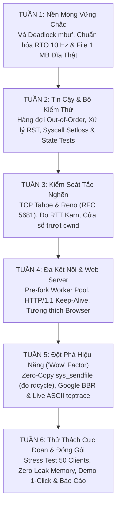

# KẾ HOẠCH TỔNG THỂ DỰ ÁN (MASTER PROJECT PLAN)
## Dự Án: Minimal TCP/IP Stack & HTTP Server trên xv6-riscv (64-bit)

> **Nhóm thực hiện:** 3 Thành viên (TV1, TV2, TV3)  
> **Thời gian:** 6 Tuần  
> **Nền tảng:** Hệ điều hành giáo dục xv6-riscv, kiến trúc phần cứng RISC-V 64-bit, Card mạng Intel E1000 ảo hóa trên QEMU.  
> **Repository:** [Minimal_TCP_HTTP_Server](https://github.com/Duc-Lee/Minimal_TCP_HTTP_Server)

---

## 1. Giới Thiệu & Mục Tiêu Dự Án

Mục tiêu của dự án là xây dựng một **ngăn xếp mạng TCP/IP tối giản (Minimal TCP/IP Stack)** hoàn chỉnh từ tầng Liên kết dữ liệu (Data Link), Mạng (Network), Giao vận (Transport) đến Ứng dụng (Application), tích hợp trực tiếp vào nhân hệ điều hành **xv6-riscv**. Trên nền tảng ngăn xếp mạng này, nhóm triển khai một **HTTP Web Server** phục vụ truyền tải dữ liệu dung lượng lớn (1 MB file) một cách tin cậy ngay cả trong điều kiện mạng khắc nghiệt (rơi gói tin ngẫu nhiên 10%).

### Ba Mức Độ Hoàn Thiện Đồ Án (Levels of Deliverables)

```
┌────────────────────────────────────────────────────────────────────────┐
│ MỨC 3: XUẤT SẮC (Chuyên sâu Hệ điều hành & Đột phá hiệu năng)           │
│ - Zero-Copy sys_sendfile (đo rdcycle CPU), Google BBR Congestion CC,   │
│ - Live ASCII tcptrace / netstat CLI, Stress test 50+ clients, 0 leak. │
├────────────────────────────────────────────────────────────────────────┤
│ MỨC 2: TỐT (Chuẩn RFC & Tối ưu hóa giao vận)                           │
│ - Hàng đợi Out-of-Order (ooo_queue), TCP Reno (Fast Retransmit/Recov), │
│ - Web Server Multi-worker Pool, HTTP/1.1 Keep-Alive, Browser support.  │
├────────────────────────────────────────────────────────────────────────┤
│ MỨC 1: ĐẠT YÊU CẦU CỐT LÕI (Baseline Minimum Viable Product)            │
│ - Bắt tay 3 bước, ACK tích lũy, Retransmit Exponential Backoff,         │
│ - Tải thành công 1 MB file khi mất gói 10%, SHA-256 khớp 100%.         │
└────────────────────────────────────────────────────────────────────────┘
```

1. **Mức 1 (Đạt yêu cầu cốt lõi - Baseline):**
   - Thiết lập kết nối 3 bước (3-Way Handshake) và đóng kết nối 4 bước (FIN/ACK).
   - Truyền nhận tin cậy với cơ chế ACK tích lũy và truyền lại khi timeout (Retransmission with Exponential Backoff).
   - Tải thành công file dung lượng 1 MB (`largefile.bin`) khi card mạng E1000 bị cấu hình mất gói ngẫu nhiên 10%.
   - Mã băm SHA-256 của file tải về trên Host khớp 100% với file gốc trong hệ thống tệp xv6.

2. **Mức 2 (Tốt - Chuẩn hóa RFC & Đa kết nối):**
   - Hàng đợi lưu trữ gói đến lệch thứ tự (`ooo_queue`), không vứt bỏ gói hợp lệ để giảm thiểu retransmission bão hòa đường truyền.
   - Thuật toán kiểm soát tắc nghẽn TCP Tahoe & TCP Reno (RFC 5681): Slow Start, Congestion Avoidance, Fast Retransmit (3 Dup-ACKs), Fast Recovery.
   - Web Server kiến trúc Multi-worker (Pre-fork pool) hỗ trợ xử lý song song nhiều kết nối đồng thời từ curl và trình duyệt web thực tế (Chrome / Firefox).

3. **Mức 3 (Xuất sắc - Nghiên cứu chuyên sâu Hệ điều hành & Đột phá hiệu năng):**
   - Lệnh gọi hệ thống Zero-Copy `sys_sendfile`: Truyền dữ liệu trực tiếp từ Buffer Cache của hệ điều hành sang card mạng, đo đạc giảm thiểu chu kỳ CPU bằng lệnh phần cứng `rdcycle`.
   - Thuật toán kiểm soát tắc nghẽn Google BBR (`CC_BBR`): Tối ưu hóa băng thông và độ trễ dựa trên đo đạc nhịp xung phần cứng thời gian thực.
   - Bộ công cụ quan sát thời gian thực trực quan trên console xv6: `netstat` và `tcptrace` vẽ biểu đồ ASCII trực tiếp.
   - Vượt qua bài kiểm tra chịu tải khắc nghiệt (Stress Test 50 client đồng thời), tỷ lệ thất thoát bộ đệm `mbuf` bằng 0 tuyệt đối (0 memory leak).

---

## 2. Ma Trận Phân Công Trách Nhiệm (33% – 33% – 33%)

Dự án được phân chia đồng đều và độc lập cao giữa 3 thành viên theo từng tầng trong mô hình mạng:

| Thành viên | Tầng phụ trách chính | Danh mục mã nguồn sở hữu | Trách nhiệm chuyên môn cốt lõi |
| :--- | :--- | :--- | :--- |
| **TV1** | **Hạ tầng Mạng & Bộ nhớ**<br>*(L2/L3 & Memory Management)* | `kernel/mbuf.c`<br>`kernel/e1000.c`<br>`kernel/eth.c`<br>`kernel/arp.c`<br>`kernel/ip.c`<br>`kernel/tcp_timer.c`<br>`kernel/checksum.c`<br>`user/setloss.c` | - Quản lý an toàn bộ nhớ đệm `mbuf`, ngăn ngừa Deadlock & rò rỉ RAM.<br>- Driver card mạng Intel E1000 & cơ chế giả lập mất gói cấu hình động (`setloss`).<br>- Giao thức Ethernet, ARP (Cache aging) & IP.<br>- Bộ đếm thời gian RTO (RTO Timer Calibration) chuẩn nhịp xung 10 Hz của phần cứng xv6. |
| **TV2** | **Tầng Giao vận & Tin cậy**<br>*(L4 Transport & Congestion Control)* | `kernel/tcp.c`<br>`kernel/tcp_input.c`<br>`kernel/tcp_output.c`<br>`kernel/tcp_cc.c`<br>`kernel/net.h`<br>`tests/state_tests.py` | - Máy trạng thái hữu hạn TCP FSM 11 trạng thái chuẩn RFC 793.<br>- Quản lý Sequence Numbers, Sliding Window & Checksum.<br>- Hàng đợi gói lệch thứ tự (`ooo_queue`) & Xử lý gói RST.<br>- Thuật toán kiểm soát tắc nghẽn: TCP Reno (RFC 5681) & Google BBR. |
| **TV3** | **Tầng Ứng dụng & Trực quan**<br>*(VFS Socket, HTTP & Observability)* | `kernel/sock.c`<br>`kernel/ringbuf.c`<br>`kernel/sysnet.c`<br>`kernel/sendfile.c`<br>`kernel/fs.c`<br>`mkfs/mkfs.c`<br>`user/httpd.c`<br>`user/netstat.c`<br>`user/tcptrace.c` | - Nâng cấp hệ thống tệp xv6 với Doubly-Indirect Block cho file 1 MB thật.<br>- Lớp trừu tượng Socket VFS & Ring Buffer đa luồng.<br>- HTTP Server Multi-worker Pool, HTTP/1.1 Keep-Alive & tương thích Browser.<br>- Zero-Copy `sys_sendfile` (đo `rdcycle`), Live ASCII dashboard & Testbed. |

---

## 3. Lộ Trình Tổng Thể 6 Tuần (Master Roadmap)



---

## 4. Mục Lục Tài Liệu Kế Hoạch Chi Tiết

Hồ sơ kế hoạch chi tiết được phân rã thành các tài liệu chuyên sâu:

### A. Kế hoạch chi tiết theo từng Thành viên:
1. [Thành viên 1: Hạ tầng Mạng, Bộ nhớ Mbuf & Giả lập Mất gói (member_1_tv1.md)](members/member_1_tv1.md)
2. [Thành viên 2: Tầng Giao vận TCP, FSM, Out-of-Order & Tắc nghẽn Reno/BBR (member_2_tv2.md)](members/member_2_tv2.md)
3. [Thành viên 3: Hệ thống tệp 1MB, Socket VFS, HTTP Server & Trực quan hóa (member_3_tv3.md)](members/member_3_tv3.md)

### B. Kế hoạch phối hợp theo từng Tuần:
1. [Tuần 1: Khảo sát, Vá lỗi Deadlock Mbuf, Chuẩn hóa Timer & File 1MB đĩa thật (week_1.md)](weeks/week_1.md)
2. [Tuần 2: Hàng đợi Out-of-Order, RFC 793 RST, Syscall Setloss & Testbed Python (week_2.md)](weeks/week_2.md)
3. [Tuần 3: Kiểm soát tắc nghẽn TCP Tahoe & Reno (RFC 5681), Đo RTT chuẩn Karn (week_3.md)](weeks/week_3.md)
4. [Tuần 4: Web Server Multi-worker, HTTP/1.1, Tương thích Trình duyệt thật & Window Scale (week_4.md)](weeks/week_4.md)
5. [Tuần 5: Zero-Copy sys_sendfile (đo rdcycle), Google BBR & Live ASCII Dashboard (week_5.md)](weeks/week_5.md)
6. [Tuần 6: Stress test chịu tải nặng, Khử rò rỉ bộ nhớ, Demo 1-Click & Hoàn thiện báo cáo (week_6.md)](weeks/week_6.md)

---

## 5. Quy Chuẩn Làm Việc & Tiêu Chí Nghiệm Thu (Definition of Done)

Để đảm bảo chất lượng kỹ thuật cao nhất khi báo cáo trước Hội đồng chấm thi, mọi tính năng được push lên git phải tuân thủ:
1. **Biên dịch sạch:** Lệnh `make clean && make -j4` không được xuất hiện bất kỳ cảnh báo (warning) hoặc lỗi biên dịch nào (`-Wall -Werror`).
2. **Không Panic, Không Treo:** Hệ điều hành xv6 không được rơi vào trạng thái Kernel Panic hoặc Deadlock khi chạy thử nghiệm tải nặng.
3. **Độ toàn vẹn dữ liệu 100%:** Mọi gói tin tải về qua mạng phải được kiểm chứng bằng mã băm SHA-256 (`sha256sum dl.bin` trùng khớp với file gốc).
4. **Git Commit rõ ràng:** Mỗi commit phải mang thông điệp chuẩn chỉ, giải thích rõ nguyên nhân (Why) và giải pháp (How).
